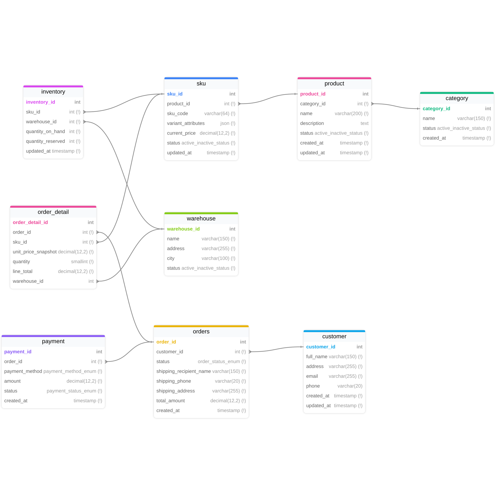
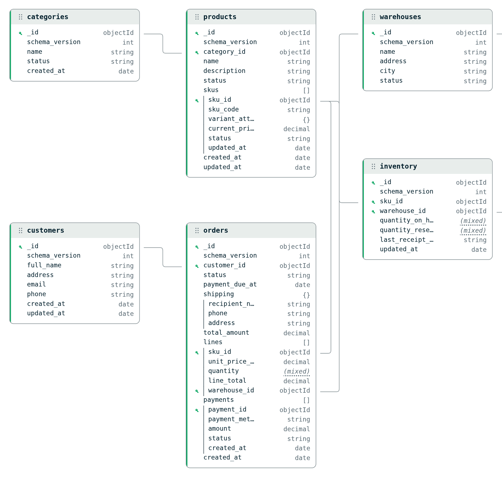
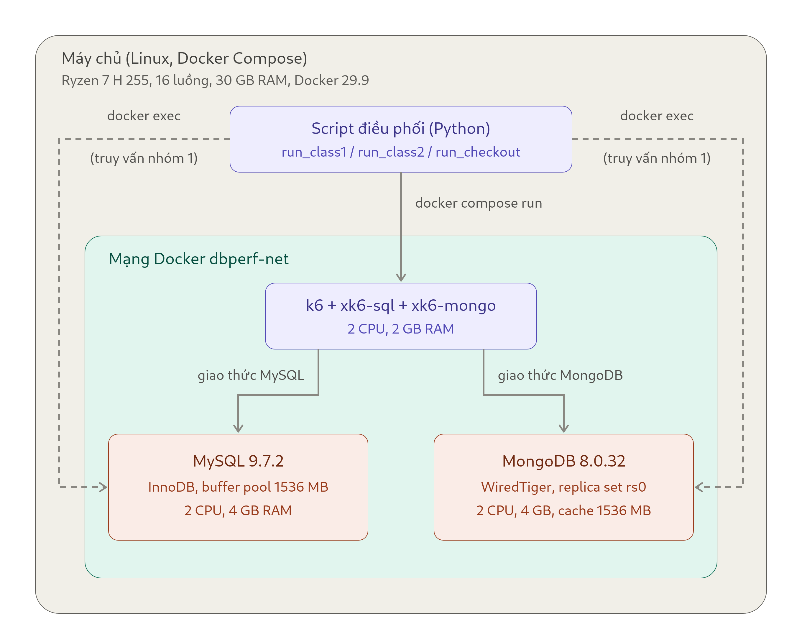
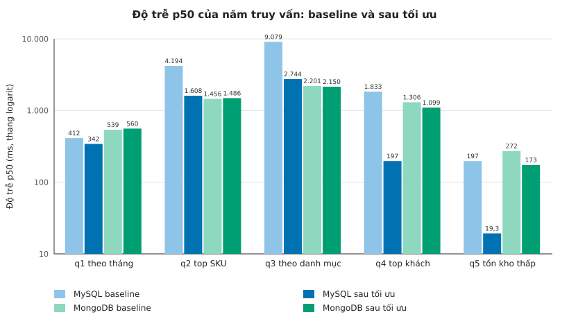
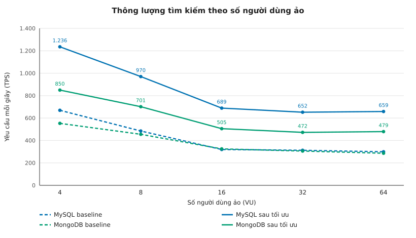
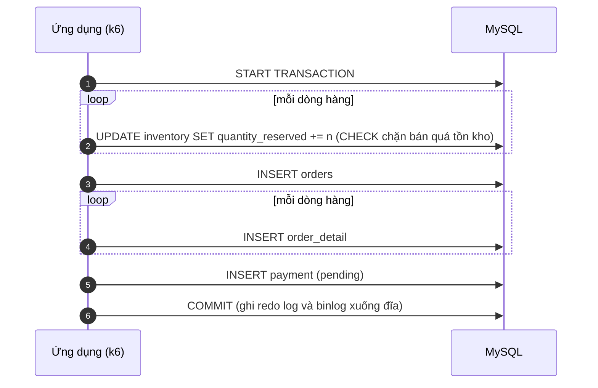
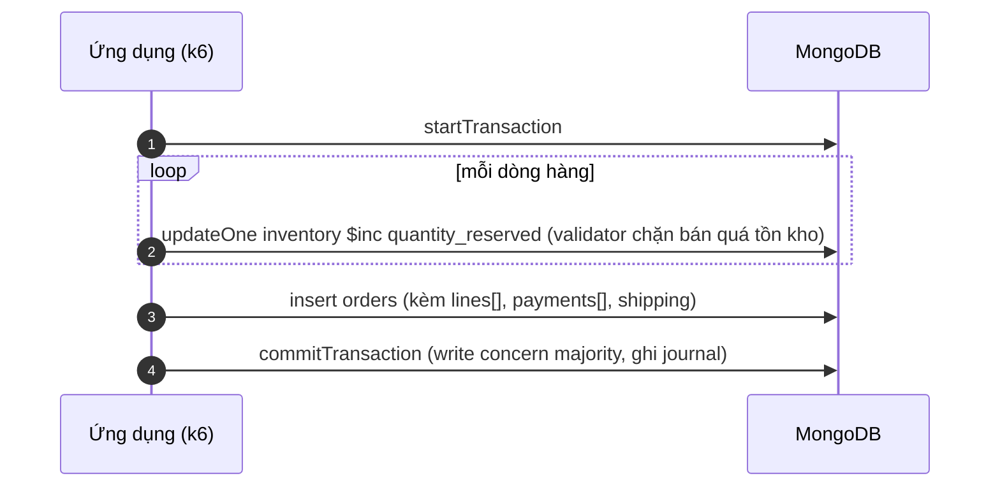
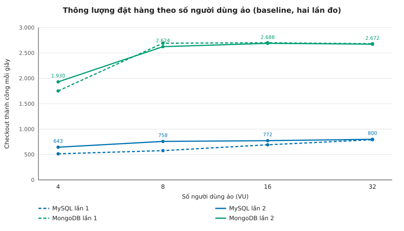
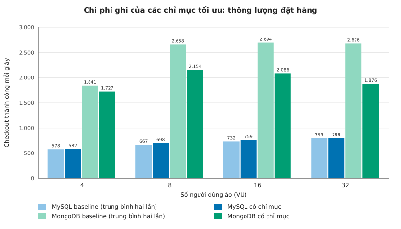

# THIẾT KẾ VÀ SO SÁNH HIỆU NĂNG MYSQL VÀ MONGODB CHO BÀI TOÁN QUẢN LÝ BÁN HÀNG

<!-- Trang bìa: do nhóm tự bổ sung trước phần Tóm tắt. -->

# TÓM TẮT

Báo cáo thiết kế và so sánh hiệu năng MySQL (InnoDB) và MongoDB (WiredTiger) cho bài toán quản lý bán hàng. **Phần I** thiết kế cùng một nghiệp vụ gồm 9 thực thể: 9 bảng chuẩn hóa 3NF với khóa ngoại, ràng buộc CHECK và cột sinh cho MySQL; 6 collection cho MongoDB, trong đó đơn hàng nhúng sẵn dòng hàng, thanh toán và địa chỉ giao hàng. **Phần II** nạp cùng 1.000.000 đơn hàng vào hai hệ (mỗi hệ 2 CPU, 4 GB RAM, bộ nhớ đệm 1536 MB) và đo ba loại nghiệp vụ trước và sau khi tối ưu: năm truy vấn báo cáo quét dữ liệu, tìm kiếm sản phẩm và đặt hàng dưới tải đồng thời (công cụ k6).

Kết quả: ở truy vấn báo cáo, MongoDB nhanh hơn ở ba trong năm truy vấn khi chưa tối ưu; sau tối ưu (chỉ mục phủ, cột sinh, viết lại truy vấn) MySQL tăng tốc từ 1,2 đến 10 lần và nhanh hơn ở ba truy vấn, còn MongoDB chỉ cải thiện đáng tin cậy ở một truy vấn. Ở tìm kiếm sản phẩm hai hệ ngang nhau lúc đầu và MySQL cao hơn khoảng 1,36 lần sau tối ưu. Ở đặt hàng, MongoDB đạt thông lượng cao hơn khoảng 3,4 lần, nhưng các chỉ mục tối ưu làm giảm 18–30% thông lượng ghi của MongoDB trong khi không ảnh hưởng đo được đến MySQL. Về dung lượng, MongoDB chiếm khoảng 56% của MySQL nhờ nén. Báo cáo rút ra bốn bài học phương pháp: chỉ mục chọn lọc thấp có thể làm chậm truy vấn; thống kê của MySQL làm thay đổi kết luận; phải đo trên toàn bộ phân phối tải; mọi tối ưu đọc đều có chi phí ghi.

**Từ khóa:** MySQL, MongoDB, InnoDB, WiredTiger, thiết kế cơ sở dữ liệu, chỉ mục, tối ưu truy vấn, hiệu năng.

---

# DANH MỤC TỪ VIẾT TẮT

| Từ viết tắt | Ý nghĩa |
|---|---|
| ACID | Atomicity, Consistency, Isolation, Durability: bốn tính chất của giao dịch |
| BSON | Binary JSON: định dạng lưu trữ tài liệu của MongoDB |
| CSDL | Cơ sở dữ liệu |
| CPU | Central Processing Unit: bộ xử lý trung tâm |
| ERD | Entity–Relationship Diagram: sơ đồ thực thể–quan hệ |
| ESR | Equality, Sort, Range: quy tắc thứ tự trường trong chỉ mục ghép của MongoDB |
| FK | Foreign Key: khóa ngoại |
| HA | High Availability: sẵn sàng cao |
| JSON | JavaScript Object Notation |
| MVCC | Multi-Version Concurrency Control: kiểm soát đồng thời nhiều phiên bản |
| p50, p95, p99 | phân vị thứ 50, 95, 99 của độ trễ |
| SKU | Stock Keeping Unit: đơn vị lưu kho, ở đây là một biến thể sản phẩm |
| SQL | Structured Query Language |
| TPS | Transactions Per Second: số yêu cầu (giao dịch) hoàn thành mỗi giây |
| VU | Virtual User: người dùng ảo của k6 |
| 3NF | Third Normal Form: dạng chuẩn thứ ba |

---

# DANH MỤC HÌNH

- Hình 3.1. Sơ đồ thực thể–quan hệ (ERD) của hệ thống quản lý bán hàng
- Hình 4.1. Sáu collection của MongoDB (nhúng và tham chiếu)
- Hình 6.1. Kiến trúc môi trường thực nghiệm
- Hình 8.1. Độ trễ p50 của năm truy vấn: baseline và sau tối ưu (thang logarit)
- Hình 9.1. Thông lượng tìm kiếm theo số người dùng ảo (baseline và sau tối ưu)
- Hình 9.2. Chuỗi thao tác của một checkout ở MySQL và ở MongoDB
- Hình 9.3. Thông lượng đặt hàng theo số người dùng ảo (baseline, hai lần đo)
- Hình 9.4. Thông lượng đặt hàng của MongoDB: không có và có các chỉ mục tối ưu

Các bảng trong báo cáo được trình bày cùng ngữ cảnh và không đánh số.

---

# MỤC LỤC

- **CHƯƠNG 1. MỞ ĐẦU**
  - 1.1 Lý do chọn đề tài
  - 1.2 Mục tiêu và câu hỏi nghiên cứu
  - 1.3 Phạm vi và giới hạn
  - 1.4 Phương pháp tiếp cận
  - 1.5 Kết quả chính
- **PHẦN I. THIẾT KẾ CƠ SỞ DỮ LIỆU CHO BÀI TOÁN QUẢN LÝ BÁN HÀNG**
- **CHƯƠNG 2. PHÂN TÍCH BÀI TOÁN**
  - 2.1 Mô tả nghiệp vụ
  - 2.2 Yêu cầu chức năng
  - 2.3 Phân tích tải và quy mô
  - 2.4 Yêu cầu phi chức năng
  - 2.5 Giả định và quyết định phạm vi
- **CHƯƠNG 3. THIẾT KẾ CƠ SỞ DỮ LIỆU QUAN HỆ (MYSQL)**
  - 3.1 Sơ đồ thực thể–quan hệ
  - 3.2 Chuẩn hóa
  - 3.3 Giao dịch và tính chất ACID trong luồng đặt hàng
  - 3.4 Nhật ký quyết định thiết kế
- **CHƯƠNG 4. THIẾT KẾ CƠ SỞ DỮ LIỆU TÀI LIỆU (MONGODB)**
  - 4.1 Quy trình thiết kế
  - 4.2 Ánh xạ quan hệ: nhúng hay tham chiếu
  - 4.3 Cấu trúc các collection
  - 4.4 Mẫu thiết kế
  - 4.5 Kiểm soát toàn vẹn bằng validator
  - 4.6 Chiến lược chỉ mục
- **CHƯƠNG 5. ĐỐI CHIẾU HAI THIẾT KẾ VÀ DỮ LIỆU THỰC NGHIỆM**
  - 5.1 Ánh xạ giữa hai thiết kế
  - 5.2 Những khác biệt có chủ đích
  - 5.3 So sánh định tính về thiết kế
  - 5.4 Dữ liệu thực nghiệm
- **PHẦN II. SO SÁNH MYSQL VÀ MONGODB**
- **CHƯƠNG 6. PHƯƠNG PHÁP SO SÁNH VÀ MÔI TRƯỜNG THỰC NGHIỆM**
  - 6.1 Hạ tầng thực nghiệm
  - 6.2 Hai nhóm nghiệp vụ
  - 6.3 Thước đo
  - 6.4 Quy trình đo và các bước tối ưu
  - 6.5 Các nguyên tắc bảo đảm so sánh công bằng
- **CHƯƠNG 7. SO SÁNH VỀ KIẾN TRÚC VÀ TÍNH NĂNG**
  - 7.1 Lưu trữ dữ liệu và chỉ mục
  - 7.2 Xử lý truy vấn và tối ưu
  - 7.3 Giao dịch và kiểm soát đồng thời
  - 7.4 Ràng buộc toàn vẹn và lược đồ
  - 7.5 Khả năng mở rộng và sẵn sàng (không đo)
  - 7.6 Tổng hợp và dẫn chiếu bằng chứng
- **CHƯƠNG 8. KẾT QUẢ NHÓM 1: TRUY VẤN QUÉT DỮ LIỆU**
  - 8.1 Thiết lập
  - 8.2 Baseline: vì sao mỗi truy vấn nhanh hoặc chậm
  - 8.3 Các tối ưu đã áp dụng
  - 8.4 Kết quả sau tối ưu
  - 8.5 Khi chỉ mục làm chậm truy vấn
  - 8.6 Thống kê của MySQL và việc chọn baseline
  - 8.7 Chi phí dung lượng của chỉ mục
  - 8.8 Nhận xét
- **CHƯƠNG 9. KẾT QUẢ NHÓM 2: HIỆU NĂNG DƯỚI TẢI ĐỒNG THỜI**
  - 9.1 Tìm kiếm sản phẩm (đọc)
  - 9.2 Đặt hàng (ghi, giao dịch)
  - 9.3 Chi phí ghi của các chỉ mục tối ưu
  - 9.4 Nhận xét về nhóm 2
- **CHƯƠNG 10. THẢO LUẬN VÀ ĐÁNH GIÁ**
  - 10.1 Tổng hợp kết quả theo loại nghiệp vụ
  - 10.2 Bài học phương pháp
  - 10.3 Khi nào nên chọn mô hình nào
  - 10.4 Mối đe dọa đối với tính hợp lệ
- **CHƯƠNG 11. KẾT LUẬN VÀ HƯỚNG PHÁT TRIỂN**
  - 11.1 Kết luận
  - 11.2 Hạn chế
  - 11.3 Hướng phát triển và khuyến nghị
- **TÀI LIỆU THAM KHẢO**

---

# CHƯƠNG 1. MỞ ĐẦU

## 1.1 Lý do chọn đề tài

MySQL, một hệ quản trị cơ sở dữ liệu (CSDL) quan hệ, là lựa chọn quen thuộc cho các hệ thống quản lý bán hàng nhờ mô hình chuẩn hóa, ràng buộc toàn vẹn và giao dịch ACID. MongoDB, một CSDL tài liệu, lưu cả thực thể tổng hợp (ví dụ một đơn hàng cùng dòng hàng và thanh toán) trong một tài liệu và thường được cân nhắc cho thương mại điện tử. Hai hướng này đánh đổi khác nhau về thiết kế, cách tối ưu truy vấn và hành vi khi nhiều người dùng truy cập đồng thời.

Bài toán quản lý bán hàng đủ các dạng nghiệp vụ tiêu biểu để so sánh: tìm kiếm sản phẩm (đọc nhiều), báo cáo tổng hợp trên toàn bộ đơn hàng (quét dữ liệu lớn) và đặt hàng (ghi nhiều bảng, giao dịch, tranh chấp tồn kho). Báo cáo thiết kế cùng một bài toán trên cả hai hệ, nạp cùng một triệu đơn hàng rồi đo và so sánh có kiểm soát.

## 1.2 Mục tiêu và câu hỏi nghiên cứu

Mục tiêu là thiết kế CSDL quản lý bán hàng trên MySQL và MongoDB, sau đó so sánh hiệu năng, tài nguyên và tác dụng của tối ưu giữa hai hệ. Báo cáo trả lời bốn câu hỏi:

1. **Thiết kế:** cùng một nghiệp vụ được biểu diễn thế nào trong mô hình quan hệ (3NF) và mô hình tài liệu (nhúng và tham chiếu), và hai thiết kế khác nhau ở đâu?
2. **Hiệu năng:** hệ nào nhanh hơn với truy vấn báo cáo, tìm kiếm sản phẩm và đặt hàng dưới tải đồng thời?
3. **Tối ưu:** chỉ mục và viết lại truy vấn cải thiện được bao nhiêu, và khi nào chúng không có tác dụng hoặc làm chậm đi?
4. **Chi phí:** tối ưu tốn thêm bao nhiêu dung lượng và làm chậm thao tác ghi đến mức nào?

## 1.3 Phạm vi và giới hạn

- **Hệ thống:** MySQL 9.7 (InnoDB) và MongoDB 8.0 (WiredTiger), mỗi hệ một nút; MongoDB chạy ở dạng replica set `rs0` để hỗ trợ giao dịch đa tài liệu.
- **Môi trường:** một máy, mỗi CSDL giới hạn 2 CPU, 4 GB RAM, bộ nhớ đệm 1536 MB; công cụ tạo tải gọi trực tiếp vào CSDL, không qua tầng ứng dụng.
- **Dữ liệu:** bộ dữ liệu tổng hợp 1.000.000 đơn hàng (mục 5.4), nhỏ hơn quy mô giả định 10 triệu đơn.
- **Ngoài phạm vi:** sao chép và chuyển đổi dự phòng (HA), phân vùng, sharding, bộ nhớ đệm ngoài, phân quyền và mã hóa chỉ được đề xuất ở Chương 11, không triển khai.

## 1.4 Phương pháp tiếp cận

Báo cáo gồm hai phần:

- **Phần I (Chương 2–5): thiết kế.** Phân tích nghiệp vụ và tải; thiết kế MySQL (3NF) và MongoDB (nhúng hoặc tham chiếu); đối chiếu hai thiết kế và nạp dữ liệu.
- **Phần II (Chương 6–10): so sánh.** Đo trước và sau tối ưu: nhóm 1 gồm năm truy vấn báo cáo quét dữ liệu, đo riêng từng truy vấn; nhóm 2 gồm tìm kiếm sản phẩm và đặt hàng, đo dưới tải đồng thời bằng Grafana k6.

Để phép so sánh công bằng, số liệu chỉ được ghi sau khi kết quả hai hệ giống hệt nhau, cấu hình tài nguyên và bộ nhớ đệm bằng nhau, và thống kê của MySQL đã được làm mới (Chương 6).

## 1.5 Kết quả chính

- **Thiết kế:** cùng 9 thực thể, MySQL dùng 9 bảng 3NF, MongoDB dùng 6 collection với đơn hàng nhúng sẵn dòng hàng, thanh toán và địa chỉ giao hàng (Chương 3–5).
- **Truy vấn báo cáo:** khi chưa tối ưu, MongoDB nhanh hơn ở ba trong năm truy vấn vì không phải nối bảng. Sau tối ưu, MySQL tăng tốc từ 1,2 đến 10 lần và nhanh hơn ở ba truy vấn; MongoDB chỉ cải thiện đáng tin cậy ở một truy vấn (1,6 lần) (Chương 8).
- **Tìm kiếm sản phẩm:** hai hệ ngang nhau lúc đầu; sau tối ưu MySQL cao hơn khoảng 1,36 lần (Chương 9).
- **Đặt hàng:** MongoDB đạt thông lượng cao hơn khoảng 3,4 lần, nhưng các chỉ mục tối ưu làm giảm 18–30% thông lượng ghi của MongoDB và không ảnh hưởng đo được đến MySQL (Chương 9).
- **Bài học phương pháp:** chỉ mục chọn lọc thấp có thể làm chậm truy vấn; thống kê của MySQL thay đổi kết luận; phải đo trên toàn bộ phân phối tải; mọi tối ưu đọc đều có chi phí ghi (Chương 10).

---

# PHẦN I. THIẾT KẾ CƠ SỞ DỮ LIỆU CHO BÀI TOÁN QUẢN LÝ BÁN HÀNG

# CHƯƠNG 2. PHÂN TÍCH BÀI TOÁN

## 2.1 Mô tả nghiệp vụ

Hệ thống mô phỏng một cửa hàng thương mại điện tử bán sản phẩm có nhiều biến thể (màu, kích cỡ), lưu hàng ở nhiều kho. Các đối tượng nghiệp vụ chính:

- **Danh mục (category):** nhóm sản phẩm phẳng, không có cây cha–con.
- **Sản phẩm (product) và biến thể (SKU):** sản phẩm là khái niệm bán hàng (ví dụ một mẫu áo); mỗi SKU là một biến thể cụ thể, có mã riêng, thuộc tính biến thể (màu, kiểu…) và giá bán hiện hành. Giá và tồn kho nằm ở mức SKU vì mỗi biến thể có thể khác giá và khác tồn.
- **Kho (warehouse) và tồn kho (inventory):** mỗi SKU có thể được lưu ở nhiều kho; tồn kho của một cặp (SKU, kho) gồm số lượng thực có và số lượng đã giữ cho các đơn chưa xuất kho.
- **Khách hàng (customer):** có địa chỉ, email (duy nhất) và số điện thoại.
- **Đơn hàng (order) và dòng hàng (order detail):** đơn thuộc một khách hàng, có trạng thái vòng đời (`pending`, `shipped`, `delivered`, `cancelled`, `returned`), địa chỉ giao hàng được lưu cố định tại thời điểm đặt và tổng tiền; mỗi dòng hàng ghi SKU, số lượng, đơn giá tại thời điểm mua và kho xuất.
- **Thanh toán (payment):** một đơn có thể có nhiều lần thanh toán (thất bại rồi thử lại), mỗi lần có phương thức (`credit_card`, `bank_transfer`, `cod`, `e_wallet`), số tiền và trạng thái (`pending`, `success`, `failed`, `refunded`) độc lập với trạng thái đơn.

Luồng nghiệp vụ trung tâm là **đặt hàng (checkout)**: tạo đơn, các dòng hàng và một thanh toán đang chờ, đồng thời tăng số lượng giữ chỗ trong tồn kho của từng (SKU, kho). Đây là giao dịch chạm nhiều thực thể và là nơi hai mô hình khác nhau nhiều nhất.

## 2.2 Yêu cầu chức năng

Các thao tác được xác định cho phần thiết kế (ký hiệu W1–W23; W10 và W22 không còn trong phạm vi):

| Nhóm | Thao tác |
|---|---|
| **Đọc: sản phẩm** | W1 liệt kê sản phẩm theo danh mục; W2 xem chi tiết sản phẩm; W3 tra theo mã SKU |
| **Đọc: đơn hàng** | W6 lịch sử đơn của khách; W7 xem một đơn; W8 lọc đơn theo ngày và trạng thái; W9 doanh thu theo tháng |
| **Đọc: khác** | W4 xem tồn kho; W5 tra khách theo email; W11 danh sách danh mục; W12 danh sách kho |
| **Ghi** | W13 đặt hàng; W14 ghi kết quả thanh toán; W15 chuyển trạng thái (`shipped` sang `delivered`); W16 xuất kho; W17 hủy hoặc trả hàng; W18–W19 đăng ký và sửa thông tin khách; W20 quản trị danh mục sản phẩm; W21 nhập kho; W23 xử lý hết hạn đơn chưa thanh toán |

Trong các thao tác ghi, W13, W16, W17 và W23 cùng thay đổi đơn hàng và tồn kho nên cần giao dịch trên nhiều bảng (MySQL) hoặc nhiều tài liệu (MongoDB).

## 2.3 Phân tích tải và quy mô

Tải được ước lượng làm cơ sở thiết kế, là **giả định của dự án chứ không phải số đo thực tế**. Tỉ lệ dưới đây là phần trăm tổng số thao tác:

| Nhóm đọc | Thao tác | Tỉ lệ |
|---|---|---|
| Sản phẩm | W1 22,7%; W2 22,8%; W3 2% | 47,5% |
| Đơn hàng | W6 9%; W7 9%; W8 1,5%; W9 0,1% | 19,6% |
| Tồn kho | W4 | 8,3% |
| Khách hàng | W5 | 6% |
| Danh mục, kho | W11 3%; W12 0,2% | 3,2% |

Tổng cộng khoảng 85% là thao tác đọc và 15% là thao tác ghi (trong đó đặt hàng W13 chiếm 3%). Sản phẩm là nhóm được truy cập nhiều nhất; tồn kho đồng thời là nhóm bị ghi nhiều nhất.

**Quy mô giả định:** 500 nghìn khách hàng, 200 nghìn SKU, 10 triệu đơn hàng; thiết kế nhắm tới việc chịu thêm 10 lần (5 triệu khách, 2 triệu SKU, 100 triệu đơn) mà không đổi cấu trúc. **Quy mô thực nghiệm** nhỏ hơn: 50 nghìn khách, 20 nghìn SKU và 1 triệu đơn (mục 5.4).

## 2.4 Yêu cầu phi chức năng

- **Độ trễ mục tiêu (giả định):** thao tác đọc có độ trễ p95 không quá 50 ms; thao tác ghi không quá 100 ms; báo cáo doanh thu theo tháng (W9) là tác vụ theo lô, không quá 30 giây.
- **Toàn vẹn:** không bán quá tồn kho; tổng tiền đơn phải bằng tổng các dòng hàng; số lượng và tiền không âm.
- **Lịch sử:** đơn hàng cũ phải giữ nguyên giá tại thời điểm mua và địa chỉ giao hàng, độc lập với thay đổi giá sản phẩm hay địa chỉ khách về sau.

## 2.5 Giả định và quyết định phạm vi

| Nội dung | Quyết định |
|---|---|
| **Định nghĩa doanh thu** | Doanh thu chỉ tính các đơn có trạng thái `delivered` (giả định của đồ án). |
| **Xóa dữ liệu** | Không xóa cứng sản phẩm, SKU, danh mục: "xóa" nghĩa là đặt `status = 'inactive'` (xóa mềm), để bảo vệ lịch sử giao dịch. |
| **Giá lịch sử** | Mỗi dòng hàng lưu đơn giá tại thời điểm mua (`unit_price_snapshot`), tách biệt với giá hiện hành của SKU. |
| **Danh mục** | Phẳng, không có cây cha–con. |
| **Không mô hình hóa** | Giỏ hàng, tài khoản nhân viên (phân quyền), thuế VAT, lịch sử trạng thái đơn, hoàn tiền tự động. Đồ án tập trung so sánh hiệu năng và giao dịch trên cùng một tải, không mô phỏng đầy đủ nghiệp vụ kế toán. |
| **Ngày của đơn** | `created_at` là thời điểm đặt đơn. |

Những lựa chọn này được ghi lại cùng lý do ở nhật ký quyết định thiết kế (mục 3.4).

---

# CHƯƠNG 3. THIẾT KẾ CƠ SỞ DỮ LIỆU QUAN HỆ (MYSQL)

## 3.1 Sơ đồ thực thể–quan hệ

Mô hình khái niệm gồm 9 thực thể. Hình 3.1 trình bày các thực thể và quan hệ; thuộc tính của từng bảng nằm trong lược đồ `schema/mysql/schema.sql`.

**Hình 3.1. Sơ đồ thực thể–quan hệ (ERD) của hệ thống quản lý bán hàng**

Số bản số của các quan hệ:

| Quan hệ | Bản số | Ghi chú |
|---|---|---|
| category – product | 1 – N | |
| product – sku | 1 – N | |
| sku – inventory | 1 – N | |
| warehouse – inventory | 1 – N | `inventory` là bảng giải quan hệ N – N giữa SKU và kho |
| customer – orders | 1 – N | |
| orders – order_detail | 1 – N | nghiệp vụ yêu cầu tối thiểu 1 dòng hàng; MySQL không ép ràng buộc này ở mức CSDL |
| sku – order_detail | 1 – N | |
| warehouse – order_detail | 1 – N | tùy chọn: kho xuất hàng của từng dòng |
| orders – payment | 1 – N | một đơn có thể có nhiều lần thanh toán |

Tách `payment` khỏi `orders` là quyết định quan trọng: phương thức và trạng thái thanh toán thuộc về từng lần thanh toán chứ không phải thuộc tính cố định của đơn, và vòng đời thanh toán độc lập với vòng đời vận chuyển. Nhờ đó luồng đặt hàng là một giao dịch kinh điển trên nhiều bảng (tạo đơn, ghi thanh toán, giữ chỗ tồn kho), phù hợp để so sánh cách hai hệ xử lý giao dịch.

## 3.2 Chuẩn hóa

Lược đồ được kiểm tra theo dạng chuẩn thứ ba (3NF): mọi thuộc tính không khóa phụ thuộc vào khóa, toàn bộ khóa và không gì ngoài khóa.

| Bảng | Đánh giá |
|---|---|
| category, product, warehouse, customer, payment | 3NF: các thuộc tính chỉ phụ thuộc vào khóa chính của bảng |
| sku | 3NF về các cột thường; cột `variant_attributes` kiểu JSON không thỏa 1NF chặt (giá trị là cấu trúc lồng), là ngoại lệ có chủ đích (xem dưới) |
| inventory | 3NF: `quantity_on_hand` và `quantity_reserved` phụ thuộc đầy đủ vào khóa tổ hợp (`sku_id`, `warehouse_id`) |
| orders | 3NF; `total_amount` là giá trị suy diễn từ các dòng hàng |
| order_detail | 3NF; `line_total` là cột sinh nên không còn là dữ liệu lưu trùng tự do |

**Ngoại lệ có chủ đích: `sku.variant_attributes` kiểu JSON.** Các thuộc tính biến thể (màu, kiểu, kích cỡ…) khác nhau giữa các nhóm sản phẩm. Ba phương án đã được cân nhắc: cột văn bản tự do (không truy vấn được theo từng thuộc tính), tách thành cột cố định hoặc bảng thuộc tính–giá trị (EAV, tốn nhiều bảng và phép nối), hoặc cột JSON. Cột JSON được chọn vì không cần định trước tập thuộc tính, vẫn lọc và đánh chỉ mục được theo từng thuộc tính (qua `JSON_EXTRACT` hoặc cột sinh), và biểu diễn tương đương với phía MongoDB, nơi các thuộc tính biến thể được nhúng trực tiếp trong tài liệu, nên thuận lợi cho việc so sánh.

**Hai cột lưu giá trị tại một thời điểm (snapshot).** `orders.shipping_*` và `order_detail.unit_price_snapshot` có vẻ lặp lại thông tin của `customer` và `sku`, nhưng chúng là sự kiện lịch sử bất biến của giao dịch (địa chỉ và giá đã dùng cho đơn đó) chứ không phải bản sao cần đồng bộ, nên không gây dị thường cập nhật và không vi phạm 3NF về ý nghĩa nghiệp vụ.

## 3.3 Giao dịch và tính chất ACID trong luồng đặt hàng

Luồng đặt hàng gồm các bước, thực hiện trong **một giao dịch InnoDB**:

1. tăng `inventory.quantity_reserved` cho từng (SKU, kho) của các dòng hàng;
2. thêm bản ghi `orders` (trạng thái `pending`, `total_amount` bằng tổng các dòng);
3. thêm các bản ghi `order_detail`;
4. thêm bản ghi `payment` (trạng thái `pending`);
5. xác nhận (`COMMIT`); nếu có lỗi ở bất kỳ bước nào thì hủy (`ROLLBACK`) toàn bộ.

| Tính chất | Cách thiết kế đáp ứng |
|---|---|
| Atomicity | các bảng bị chạm là các bảng độc lập, bọc được trong một giao dịch; lỗi giữa chừng thì hủy toàn bộ |
| Consistency | NOT NULL, CHECK, FK, ENUM, cột sinh; riêng `total_amount` do ứng dụng giữ |
| Isolation | rủi ro chính nằm ở `inventory`: hai đơn cùng đặt một (SKU, kho) có thể tranh chấp. Lệnh `UPDATE ... SET quantity_reserved = quantity_reserved + n` khóa dòng tồn kho đến khi giao dịch kết thúc, và CHECK `quantity_reserved ≤ quantity_on_hand` được kiểm tra khi lệnh chạy nên không thể giữ quá tồn kho. Có thể dùng thêm `SELECT ... FOR UPDATE` hoặc cột `version` (khóa lạc quan); thiết kế chưa thêm cột `version` vì không bắt buộc |
| Durability | do nhật ký ghi trước (redo log) của InnoDB đảm nhiệm, không phải thuộc tính của lược đồ |

## 3.4 Nhật ký quyết định thiết kế

| Vấn đề | Quyết định | Lý do |
|---|---|---|
| Biểu diễn trạng thái và phương thức thanh toán | `ENUM` riêng trên từng bảng | Đã thử gộp vào một bảng tra cứu dùng chung (mẫu "one true lookup table") rồi bỏ: khóa ngoại không bảo đảm đúng loại giá trị (gán nhầm một giá trị phương thức thanh toán vào trạng thái đơn không bị DB chặn, đã kiểm chứng), trong khi lợi ích là ít bảng hơn, không đáng với quy mô nhỏ của miền này |
| Trạng thái thanh toán và vận chuyển | Tách `payment` khỏi `orders`, `orders.status` chỉ phản ánh vòng đời đơn | Trước đây một trạng thái gộp cả hai gây mơ hồ (đơn đã gửi rồi bị hủy nghĩa là gì?); "đã thanh toán" được suy ra từ sự tồn tại một thanh toán `success` |
| Lịch sử trạng thái đơn | Bỏ bảng `order_status_history` | Đơn giản hóa; `orders.status` là nguồn duy nhất, đánh đổi là không còn nhật ký chuyển trạng thái và không còn truy vấn "đơn nằm ở trạng thái X bao lâu" |
| Snapshot ở dòng hàng | Chỉ giữ `unit_price_snapshot`, bỏ snapshot tên, mã, biến thể | Đáp ứng yêu cầu lưu giá lịch sử; hệ quả là hiển thị tên SKU của đơn cũ phải đọc từ `sku` và `product` hiện hành |
| Thuộc tính biến thể | Cột JSON | Xem mục 3.2 |
| Giá trị dẫn xuất | `line_total` là cột sinh STORED; `total_amount` là quy ước ứng dụng | STORED vì cột được đọc thường xuyên (lịch sử đơn, báo cáo doanh thu), tính một lần khi ghi; `total_amount` là phép tổng hợp liên dòng nên không thể là cột sinh |
| Xóa dữ liệu | Khóa ngoại `ON DELETE RESTRICT` kết hợp xóa mềm (`status = 'inactive'`) | Không cho xóa cứng dữ liệu còn được tham chiếu; truy vấn danh mục lọc `status = 'active'`, truy vấn lịch sử đơn không lọc vì đã có snapshot |
| Phạm vi nghiệp vụ | Bỏ giỏ hàng, tài khoản nhân viên, thuế VAT, danh mục phân cấp | Không nằm trong tải đã lên kế hoạch; đồ án tập trung so sánh hiệu năng và giao dịch |
| Kiểu dữ liệu | `INT UNSIGNED` cho khóa; `DECIMAL(12,2)` cho tiền; `SMALLINT UNSIGNED` cho số lượng một dòng | Đủ dung lượng, nhỏ gọn; tránh sai số của số thực |
| Theo dõi sửa đổi | `updated_at` tự cập nhật trên `product`, `sku`, `inventory`, `customer` | Đồng nhất việc theo dõi lần sửa cuối trên các bảng dữ liệu chính |
| Khóa lạc quan trên tồn kho | Không thêm cột `version` | Tùy chọn, không bắt buộc; dựa vào khóa dòng và CHECK |

---

# CHƯƠNG 4. THIẾT KẾ CƠ SỞ DỮ LIỆU TÀI LIỆU (MONGODB)

## 4.1 Quy trình thiết kế

Thiết kế MongoDB đi theo bốn bước, xuất phát từ tải chứ không từ sơ đồ bảng:

1. **Xác định tải:** danh sách thao tác, tỉ lệ, quy mô và kích thước tài liệu (Chương 2).
2. **Ánh xạ quan hệ:** với mỗi quan hệ khóa ngoại của ERD, quyết định nhúng (embed) hay tham chiếu (reference), dựa trên số phần tử trung bình và tối đa, mức độ đọc cùng nhau, và việc có trần hay không.
3. **Áp dụng mẫu thiết kế:** chọn các mẫu giải quyết vấn đề cụ thể (giá lịch sử, giá trị tính sẵn, phiên bản lược đồ).
4. **Tạo chỉ mục:** chỉ mục bắt buộc cho tính duy nhất, cộng các chỉ mục tối ưu thiết kế theo quy tắc ESR (equality, sort, range).

Nguyên tắc nhúng: nhúng khi quan hệ có trần số phần tử và các phần tử thường được đọc cùng thực thể cha; tham chiếu khi số phần tử không có trần hoặc tăng theo thời gian. Tài liệu MongoDB giới hạn kích thước một tài liệu ở 16 MiB, nên mảng không có trần không được nhúng.

## 4.2 Ánh xạ quan hệ: nhúng hay tham chiếu

Chín quan hệ khóa ngoại của ERD được ánh xạ thành sáu collection. Các giá trị N là ước lượng theo giả định về tải (Chương 2).

| Quan hệ | N trung bình / tối đa | Quyết định | Lý do |
|---|---|---|---|
| product → sku | 3 / 50 | **Nhúng** `products.skus[]` | có trần; đọc cùng sản phẩm ở W2 |
| orders → order_detail | 3 / 50 | **Nhúng** `orders.lines[]` | có trần; bất biến sau khi đặt hàng |
| orders → payment | 1,2 / 5 | **Nhúng** `orders.payments[]` | có trần |
| orders → địa chỉ giao hàng | 1 | **Nhúng** `orders.shipping{}` | snapshot địa chỉ lúc đặt |
| category → product | khoảng 133, lệch | **Tham chiếu** `products.category_id` | không có trần |
| customer → orders | 20 / 2.000 | **Tham chiếu** `orders.customer_id` | không có trần, tăng theo thời gian |
| warehouse → inventory | 60.000 | **Tham chiếu** `inventory.warehouse_id` | không có trần |
| sku → inventory | 3 / 10 | **Collection riêng**, mỗi tài liệu là một cặp (SKU, kho) | tồn kho bị ghi ở mỗi đơn (khoảng 6,6% tổng thao tác) trong khi catalog được đọc 47,5%; tách ra để không phải ghi lại tài liệu catalog và không tranh chấp với thao tác đọc |
| sku, kho → dòng hàng | không có trần | **Tham chiếu** `lines[].sku_id`, `lines[].warehouse_id` (tùy chọn) | dòng hàng chỉ kèm snapshot giá |

**Hình 4.1. Sáu collection của MongoDB (nhúng và tham chiếu)**

Trong sơ đồ, các mảng và đối tượng lồng (`skus[]`, `lines[]`, `payments[]`, `shipping{}`) là các phần nhúng bên trong tài liệu cha, không phải collection riêng; các đường nối giữa các collection là tham chiếu qua các trường có biểu tượng chìa khóa (`category_id`, `customer_id`, `sku_id`, `warehouse_id`).

**Hệ quả của lựa chọn.** Các thao tác đọc ưu tiên cao (W1, W2, W5, W6, W7, W8, W9, W13, W14, W15) đều không cần `$lookup`: một đơn hàng được đọc trọn trong một tài liệu cùng dòng hàng, thanh toán và địa chỉ giao. Đổi lại, vì `inventory` tách riêng nên các thao tác đặt hàng, xuất kho, hủy hoặc trả hàng và hết hạn đơn chạm nhiều tài liệu và cần giao dịch đa tài liệu (xem mục 9.2.1). Toàn vẹn tham chiếu do ứng dụng đảm nhiệm vì MongoDB không có khóa ngoại, kèm quy ước không xóa cứng. Do ERD đã bỏ snapshot tên và mã SKU ở dòng hàng, muốn hiển thị chúng cho một đơn cũ (W7) ứng dụng phải đọc thêm `products` theo `skus.sku_id` (một truy vấn dùng chỉ mục).

## 4.3 Cấu trúc các collection

| Collection | Trường |
|---|---|
| `categories` | `_id`, `schema_version`, `name`, `status`, `created_at` |
| `products` | `_id`, `schema_version`, `category_id`, `name`, `description?`, `status`, `skus[]`, `created_at`, `updated_at` |
| `products.skus[]` | `sku_id`, `sku_code` (chữ hoa), `variant_attributes` (tối đa 8 khóa), `current_price`, `status`, `updated_at` |
| `warehouses` | `_id`, `schema_version`, `name`, `address`, `city`, `status` |
| `inventory` | `_id`, `schema_version`, `sku_id`, `warehouse_id`, `quantity_on_hand`, `quantity_reserved`, `last_receipt_id?`, `updated_at` |
| `customers` | `_id`, `schema_version`, `full_name`, `address`, `email` (chữ thường), `phone?`, `created_at`, `updated_at` |
| `orders` | `_id`, `schema_version`, `customer_id`, `status`, `payment_due_at?`, `shipping{recipient_name, phone, address}`, `total_amount`, `lines[]`, `payments[]`, `created_at` |
| `orders.lines[]` | `sku_id`, `unit_price_snapshot`, `quantity`, `line_total`, `warehouse_id?` |
| `orders.payments[]` | `payment_id`, `payment_method`, `amount`, `status`, `created_at` |

Dấu `?` là trường tùy chọn: khi không có giá trị thì vắng mặt chứ không bao giờ là `null`. Tiền dùng kiểu `Decimal128`, thời gian dùng kiểu ngày BSON, khóa dùng `ObjectId` do máy khách sinh. `last_receipt_id` (nhập kho idempotent) và `payment_due_at` (hết hạn đơn chưa thanh toán) là hai trường chỉ có ở MongoDB, phục vụ hai thao tác W21 và W23.

**Kích thước tài liệu.** Kích thước điển hình, tối đa theo validator và trung bình đo trên bộ dữ liệu thực nghiệm (1 triệu đơn):

| Collection | Điển hình (B) | Tối đa theo validator (B) | Trung bình đo được (B) |
|---|---|---|---|
| categories | 99 | 542 | — |
| warehouses | 138 | 1.612 | — |
| inventory | 153 | 247 | 153 |
| customers | 210 | 1.626 | 236 |
| products | 1.711 (3 SKU, mô tả 1.000 ký tự) | 157.706 (50 SKU, mô tả 4.000 ký tự) | 1.952 |
| orders | 806 (3 dòng, 1 thanh toán) | 8.746 (50 dòng, 5 thanh toán) | 849 |

Tài liệu lớn nhất (`products`) dưới 1% giới hạn 16 MiB. Kích thước thực đo của `orders` (849 B) và `products` (1.952 B) cao hơn giá trị điển hình một chút vì dữ liệu thực có trung bình 3,12 dòng hàng mỗi đơn và khoảng 5 SKU mỗi sản phẩm.

## 4.4 Mẫu thiết kế

| Mẫu | Dùng ở | Vấn đề giải quyết |
|---|---|---|
| **Extended Reference** (snapshot bất biến) | `orders.lines[].unit_price_snapshot` | giữ đúng giá lúc mua; đọc đơn không cần tra catalog để biết giá |
| **Computed** (tính khi ghi) | `lines[].line_total`, `orders.total_amount` | doanh thu theo tháng chỉ cần đọc `total_amount` từ chỉ mục thay vì đọc cả tài liệu; tương đương cột sinh của MySQL |
| **Schema Versioning** | trường `schema_version` ở mọi tài liệu | di chuyển lược đồ theo kiểu mở rộng rồi thu hẹp, không cần ngừng hệ thống |

Các mẫu đã cân nhắc nhưng không dùng vì chưa có vấn đề đo được cần giải quyết: Bucket, Attribute, Polymorphic, Subset, Outlier, Approximation, Archive, Document Versioning. Mẫu Tree (lưu đường dẫn tổ tiên) bị bỏ vì danh mục đã là danh mục phẳng. Báo cáo cũng cố ý không tổng hợp trước doanh thu (mẫu Computed ở mức báo cáo) để các truy vấn báo cáo ở Chương 8 so sánh công bằng giữa hai hệ.

## 4.5 Kiểm soát toàn vẹn bằng validator

Mỗi collection có validator `$jsonSchema` với `validationLevel: strict` và `additionalProperties: false` (không cho trường lạ), kèm biểu thức `$expr` để ép các đẳng thức mà `$jsonSchema` không biểu diễn được:

- `line_total = quantity × unit_price_snapshot`;
- `total_amount = Σ lines.line_total` (MySQL chỉ giữ quy ước ở tầng ứng dụng);
- `quantity_reserved ≤ quantity_on_hand` (tương đương CHECK của MySQL);
- không trùng `sku_id` hoặc `sku_code` trong một sản phẩm, không trùng `payment_id` trong một đơn (chỉ mục unique chỉ so sánh giữa các tài liệu nên không bắt được trường hợp trùng trong cùng một tài liệu);
- `payment_due_at` chỉ tồn tại khi đơn ở trạng thái `pending`.

Validator còn giới hạn kích thước mảng (tối đa 50 SKU mỗi sản phẩm, 50 dòng hàng và 5 thanh toán mỗi đơn), tối đa 8 thuộc tính biến thể, giá trị tiền không âm và không vượt `9.999.999.999,99` (cùng miền với `DECIMAL(12,2)`), và chuẩn hóa chữ hoa, chữ thường (`sku_code` viết hoa, `email` viết thường) để việc kiểm tra tính duy nhất tương đương với MySQL, nơi cột chuỗi không phân biệt hoa thường.

## 4.6 Chiến lược chỉ mục

**Chỉ mục đã tạo cùng lược đồ** (bốn chỉ mục unique, tương ứng các UNIQUE KEY của MySQL): `products.skus.sku_id`, `products.skus.sku_code`, `inventory (sku_id, warehouse_id)`, `customers.email`. Ngoài ra chỉ có chỉ mục `_id` mặc định. Khác với MySQL, MongoDB **không** tự tạo chỉ mục cho các trường tham chiếu như `orders.customer_id`, nên ở mức xuất phát truy vấn theo khách hàng phải quét toàn bộ collection. Sự khác biệt này được ghi nhận khi phân tích kết quả ở Phần II.

**Chỉ mục tối ưu theo thiết kế** (xây dựng theo quy tắc ESR, đã kiểm tra bằng `explain()` trên mẫu tổng hợp 50.000 đơn, chỉ để so sánh trước và sau):

| Chỉ mục | Khóa | Phục vụ | Ghi chú |
|---|---|---|---|
| `ix_orders_customer_summary` | `customer_id`, `created_at↓`, `_id↓`, `status`, `total_amount` | W6 | covered query; `_id` đứng trước `status` và `total_amount` để thứ tự sắp xếp khớp thứ tự chỉ mục |
| `ix_orders_status_date` | `status`, `created_at`, `total_amount` | W8, W9 | equality trước, sort và range cùng trên `created_at`; `total_amount` giúp W9 là covered query |
| `ix_orders_payment_due` | `payment_due_at` (chỉ mục một phần) | W23 | chỉ chứa các đơn đang chờ thanh toán |
| `ix_products_category_listing` | `category_id`, `status`, `created_at↓`, `_id↓` | W1 | chỉ mục một khóa thông thường |

Kết quả `explain()` trên mẫu: W6 giảm từ quét 50.000 tài liệu xuống 20 khóa và 0 tài liệu; W9 (cửa sổ một năm) chỉ đọc khóa chỉ mục, 0 tài liệu; W1 giảm từ 5.000 tài liệu xuống 20 tài liệu và không còn bước sắp xếp.

**Lưu ý quan trọng về phạm vi.** Bốn chỉ mục trên là thiết kế cho tải W1, W6, W8, W9, W23; chúng **chưa được tạo trong các thực nghiệm của báo cáo này**. Thực nghiệm ở Chương 8 và 9 đo năm truy vấn báo cáo (q1–q5), tìm kiếm sản phẩm và đặt hàng; các chỉ mục dùng cho chúng được thiết kế riêng và trình bày tại đó.

**Chi phí ghi.** Mỗi đơn mới ghi ba mục chỉ mục khi chèn (`_id`, `ix_orders_customer_summary` và `ix_orders_status_date`), thêm một mục cho `ix_orders_payment_due` nếu đơn không phải thanh toán khi nhận hàng; mỗi lần đổi `status` phải viết lại hai mục chỉ mục. Chi phí này được đo trực tiếp cho các chỉ mục thực nghiệm ở mục 9.3.

---

# CHƯƠNG 5. ĐỐI CHIẾU HAI THIẾT KẾ VÀ DỮ LIỆU THỰC NGHIỆM

## 5.1 Ánh xạ giữa hai thiết kế

Hai thiết kế biểu diễn cùng 9 thực thể nghiệp vụ:

| Thực thể | MySQL (9 bảng) | MongoDB (6 collection) |
|---|---|---|
| Danh mục | `category` | `categories` |
| Sản phẩm | `product` | `products` |
| Biến thể sản phẩm (SKU) | `sku` | `products.skus[]` (nhúng) |
| Kho | `warehouse` | `warehouses` |
| Tồn kho | `inventory` | `inventory` |
| Khách hàng | `customer` | `customers` |
| Đơn hàng | `orders` | `orders` |
| Dòng hàng | `order_detail` | `orders.lines[]` (nhúng) |
| Thanh toán | `payment` | `orders.payments[]` (nhúng) |

Địa chỉ giao hàng nằm ở ba cột `shipping_*` của `orders` trong MySQL và ở đối tượng nhúng `orders.shipping` trong MongoDB.

## 5.2 Những khác biệt có chủ đích

| Nội dung | MySQL | MongoDB |
|---|---|---|
| Toàn vẹn tham chiếu | 9 khóa ngoại `ON DELETE RESTRICT` do CSDL kiểm tra | không có khóa ngoại; ứng dụng giữ toàn vẹn và quy ước không xóa cứng |
| Tổng tiền đơn (`total_amount`) | cột thường, ràng buộc duy nhất ở CSDL là `≥ 0`; đẳng thức với tổng dòng hàng là quy ước ứng dụng | validator ép `total_amount = Σ line_total` |
| Dòng hàng sau khi tạo | không có ràng buộc ngăn việc sửa | quy ước không sửa dòng hàng sau khi tạo đơn |
| Quy tắc chuỗi | cột chuỗi không phân biệt hoa thường theo collation | MongoDB chặt hơn: `sku_code` lưu chữ hoa, `email` lưu chữ thường, để tính duy nhất tương đương |
| Kho của dòng hàng | cột `warehouse_id` cho phép NULL | trường `lines[].warehouse_id` tùy chọn (vắng mặt thay vì null) |
| Giới hạn mảng | không áp dụng (các dòng ở bảng riêng) | tối đa 50 SKU mỗi sản phẩm, 50 dòng hàng và 5 thanh toán mỗi đơn |
| Trường riêng của MongoDB | | `inventory.last_receipt_id` (nhập kho idempotent), `orders.payment_due_at` (hết hạn đơn chưa thanh toán), `schema_version` |
| Khóa chính | số nguyên tự tăng | `ObjectId` do máy khách sinh |

## 5.3 So sánh định tính về thiết kế

| Khía cạnh | MySQL (chuẩn hóa) | MongoDB (nhúng) |
|---|---|---|
| Đọc một đơn đầy đủ | nối 3 bảng (`orders`, `order_detail`, `payment`); muốn hiện tên SKU phải nối thêm `sku`, `product` | một tài liệu; tên SKU phải đọc thêm từ `products` vì dòng hàng chỉ lưu snapshot giá |
| Ghi một đơn mới | một dòng `orders`, mỗi dòng hàng một dòng `order_detail`, một dòng `payment` (trong kịch bản đo, khoảng 7 đến 10 câu lệnh kể cả mở và đóng giao dịch) | một phép chèn tài liệu cùng một phép cập nhật cho mỗi dòng hàng tồn kho |
| Liệt kê sản phẩm theo danh mục kèm giá | nối `product` với `sku` | một tài liệu sản phẩm đã chứa các biến thể |
| Trùng lặp dữ liệu | tối thiểu theo 3NF | có chủ đích: snapshot giá, địa chỉ giao, dòng hàng nằm cùng đơn |
| Thay đổi lược đồ | `ALTER TABLE`, ảnh hưởng toàn bảng | thêm trường tùy chọn không cần di chuyển dữ liệu; `schema_version` hỗ trợ di chuyển dần |
| Đảm bảo toàn vẹn | khai báo ở CSDL (FK, CHECK, ENUM) | validator và ứng dụng |
| Truy vấn báo cáo trên dòng hàng | trực tiếp trên bảng `order_detail` | phải mở mảng `lines[]` (`$unwind`) |

Những khác biệt này không có "thắng thua" tuyệt đối; chúng chỉ ra loại thao tác nào thuận lợi cho mỗi mô hình và là căn cứ để giải thích các kết quả đo ở Phần II.

## 5.4 Dữ liệu thực nghiệm

Bộ dữ liệu `bigdata-final` là dữ liệu tổng hợp, được tạo bằng một trình sinh dữ liệu nằm ngoài kho mã của đồ án (phiên bản 0.1.0, hạt giống 20261024, ngày 2026-10-28), xuất ra hai định dạng tương ứng cho MySQL (tệp CSV) và MongoDB (tệp JSON Lines). Tên và thuộc tính sản phẩm dựa trên tập mô tả mặt hàng của H&M, địa chỉ khách và kho dựa trên dữ liệu địa danh GeoNames; giá tổng hợp bằng USD với trung vị 25. Vì trình sinh nằm ngoài kho, bộ dữ liệu không thể sinh lại hay mở rộng quy mô từ kho mã.

| Thực thể | Số lượng |
|---|---|
| Danh mục | 19 |
| Sản phẩm | 4.000 |
| SKU | 20.000 (19.402 `active`, 598 `inactive`) |
| Kho | 20 |
| Tồn kho (cặp SKU–kho) | 321.410 (trung bình 16,1 kho mỗi SKU) |
| Khách hàng | 50.000 |
| Đơn hàng | **1.000.000** |
| Dòng hàng | 3.117.170 (trung bình 3,12 dòng mỗi đơn) |
| Thanh toán | 1.038.361 |

Phân phối trạng thái đơn: `delivered` 960.500 (96,05%), `cancelled` 12.300 (1,23%), `shipped` 11.000 (1,10%), `returned` 10.000 (1,00%), `pending` 6.200 (0,62%). Tỉ lệ rất lệch về `delivered` có ảnh hưởng trực tiếp đến hiệu quả của chỉ mục ở Chương 8. Phân phối phương thức thanh toán: thẻ tín dụng 71,7%, chuyển khoản 18,1%, ví điện tử 5,3%, thanh toán khi nhận hàng 4,9%. Số dòng hàng mỗi đơn: 1 dòng ở 331.810 đơn, 2 dòng ở 236.819 đơn, 3 dòng ở 145.351 đơn, từ 4 dòng ở 286.020 đơn. Tồn kho thực có mỗi cặp từ 20 đến 506 đơn vị (trung bình 260,5), có 18.391 cặp đang giữ chỗ cho 6.200 đơn `pending` (tổng số lượng giữ chỗ 22.096).

---

# PHẦN II. SO SÁNH MYSQL VÀ MONGODB

# CHƯƠNG 6. PHƯƠNG PHÁP SO SÁNH VÀ MÔI TRƯỜNG THỰC NGHIỆM

## 6.1 Hạ tầng thực nghiệm

Toàn bộ thực nghiệm chạy trên một máy (CPU AMD Ryzen 7 H 255, 16 luồng, 30 GB RAM, Linux, Docker 29.9) bằng Docker Compose. Hình 6.1 mô tả kiến trúc.

**Hình 6.1. Kiến trúc môi trường thực nghiệm**

| Thành phần | Cấu hình |
|---|---|
| MySQL | 9.7.2 (nhánh hỗ trợ dài hạn), InnoDB; giới hạn 2 CPU, 4 GB; `innodb_buffer_pool_size = 1536M` |
| MongoDB | 8.0.32, WiredTiger, replica set một nút `rs0`; giới hạn 2 CPU, 4 GB; `wiredTigerCacheSizeGB = 1.5` |
| Công cụ tạo tải | Grafana k6 2.3.0 dựng kèm `xk6-sql` 1.2.4 (trình điều khiển MySQL 0.4.3) và `xk6-mongo` 1.4.0; gọi trực tiếp vào CSDL, không qua tầng ứng dụng; giới hạn 2 CPU, 2 GB |
| Lưu trữ | mỗi CSDL một volume Docker có tên |
| Điều phối | script Python chỉ dùng thư viện chuẩn, gọi `docker exec` hoặc `docker compose run` |

**Cân bằng bộ nhớ đệm.** Với cấu hình mặc định, hai hệ có bộ nhớ đệm rất khác nhau: bộ đệm InnoDB là 128 MB trong khi WiredTiger tự lấy 50% của (RAM − 1 GB) = 1536 MB. Với dữ liệu MySQL ~564 MB (dữ liệu và chỉ mục), MySQL chỉ giữ được khoảng một phần tư trong bộ nhớ. Vì vậy cả hai được đặt tường minh bằng 1536 MB trước mọi phép đo, và mọi số liệu trong báo cáo đều ở cấu hình này.

## 6.2 Hai nhóm nghiệp vụ

**Nhóm 1: truy vấn báo cáo quét dữ liệu.** Năm truy vấn ít khi chạy nhưng đọc rất nhiều dữ liệu, so sánh từng truy vấn riêng lẻ (độ trễ và kế hoạch thực thi). Doanh thu chỉ tính đơn `delivered`.

| Truy vấn | Nghiệp vụ | Dữ liệu phải đọc |
|---|---|---|
| q1 | Doanh thu theo tháng | `orders` (toàn bộ, 96% là `delivered`) |
| q2 | Top 20 SKU bán chạy năm 2019 (theo số lượng) | `orders` + `order_detail` + `sku` / `orders.lines[]` + `products` |
| q3 | Doanh thu theo danh mục sản phẩm (toàn thời gian) | `order_detail` + `sku` + `product` + `category` / `orders.lines[]` + `products` + `categories` |
| q4 | Top 20 khách theo tổng chi tiêu | `orders` + `customer` / `orders` + `customers` |
| q5 | Báo cáo tồn kho thấp theo kho (khả dụng ≤ 25) | `inventory` + `sku` + `product` + `warehouse` / `inventory` + `products` + `warehouses` |

**Nhóm 2: luồng người dùng dưới tải đồng thời.** Hai nghiệp vụ tần suất cao, đo bằng k6 với nhiều người dùng ảo (VU) chạy liên tục không nghỉ:

- **Tìm kiếm sản phẩm** (đọc): mỗi yêu cầu chọn một danh mục (theo trọng số kích thước danh mục), tùy chọn lọc theo màu (50% yêu cầu), khoảng giá (60%), từ khóa tên (30%), rồi phân trang (trang 0–7). Đo ở 4, 8, 16, 32 và 64 VU.
- **Đặt hàng** (ghi, giao dịch): mỗi yêu cầu đặt một đơn `pending` kèm một thanh toán `pending`, từ 1 đến 3 dòng hàng lấy từ một đơn mẫu có sẵn, tăng số lượng giữ chỗ của từng (SKU, kho); 50% yêu cầu dùng các đơn mẫu "nóng" (chứa một trong 200 SKU bán nhiều nhất) để tạo tranh chấp khóa trên cùng các dòng tồn kho. Khi xung đột (deadlock ở MySQL, `WriteConflict` ở MongoDB), giao dịch được làm lại, tối đa 3 lượt thử kể cả lượt đầu. Đo ở 4, 8, 16 và 32 VU.

Hai nghiệp vụ được đo riêng, không trộn tải.

## 6.3 Thước đo

| Nhóm | Thước đo | Cách lấy |
|---|---|---|
| Nhóm 1 | độ trễ p50 và p95 của 11 lần chạy (lần chạy đầu ghi riêng); kế hoạch thực thi | thời gian đo **ngay trong phiên CSDL**, không gồm thời gian khởi động tiến trình: MySQL đọc `TIMER_WAIT` từ `performance_schema`, MongoDB dùng `performance.now()`; kế hoạch từ `EXPLAIN ANALYZE` (MySQL) và `explain("executionStats")` (MongoDB) |
| Nhóm 2 | thông lượng (TPS), độ trễ p50, p95, p99 | từ k6: số vòng lặp hoàn thành mỗi giây (tìm kiếm) hoặc số checkout thành công mỗi giây (đặt hàng); độ trễ là thời gian của một yêu cầu, kể cả các lần thử lại |
| Tài nguyên | CPU của CSDL và của k6 khi tải; dung lượng dữ liệu và chỉ mục | `docker stats`; `information_schema.tables` (MySQL) và `collStats` (MongoDB) |

## 6.4 Quy trình đo và các bước tối ưu

Để biết phần cải thiện đến từ đâu, mỗi nghiệp vụ được đo qua các bước, mỗi bước chỉ đổi một yếu tố:

| Bước | Lược đồ | Truy vấn hoặc yêu cầu |
|---|---|---|
| Baseline | chỉ chỉ mục bắt buộc (khóa chính, khóa ngoại, unique) | gốc |
| Chỉ thêm chỉ mục | thêm chỉ mục và cột dẫn xuất | gốc, giữ nguyên |
| Tối ưu đầy đủ | như bước trên | viết lại truy vấn hoặc yêu cầu |

Tối ưu chỉ gồm chỉ mục, cột dẫn xuất (cột sinh ở MySQL, trường lưu sẵn ở MongoDB) và viết lại truy vấn; không thay đổi cấu hình máy chủ. Mỗi bộ tối ưu có script áp dụng và script hoàn nguyên; sau khi hoàn nguyên danh sách chỉ mục được so với ban đầu và baseline được đo lại để kiểm tra khả năng tái lập.

## 6.5 Các nguyên tắc bảo đảm so sánh công bằng

1. **Kết quả giống hệt trước khi đo.** Mỗi cặp truy vấn nhóm 1 phải cho kết quả giống nhau từng byte ở hai CSDL, và mọi bước tối ưu phải cho kết quả giống baseline; nếu không, không ghi số liệu. Với tìm kiếm, 60 yêu cầu cố định phải trả cùng kết quả (cùng thứ tự và giá). Với đặt hàng, sau cùng một dãy 40 yêu cầu cố định, nội dung các đơn mới và 232 dòng tổng hợp nghiệp vụ phải trùng khớp.
2. **Cùng tài nguyên và bộ nhớ đệm** (mục 6.1).
3. **Làm mới thống kê của MySQL (`ANALYZE TABLE`) trước baseline.** Thống kê cũ từ lúc nạp dữ liệu làm thay đổi kế hoạch thực thi và bóp méo kết luận (Chương 8 và 9). Mọi mức tăng tốc được tính theo baseline đã làm mới thống kê.
4. **Cùng chuỗi tham số cho hai CSDL:** bộ sinh số giả ngẫu nhiên xác định theo (VU, lần lặp).
5. **Kiểm tra điểm nghẽn.** Khi tải, CPU của CSDL chạm trần (175–200% trên 200% được cấp) còn k6 chỉ dùng 5–88% CPU, nên số đo phản ánh CSDL chứ không phải công cụ tạo tải.
6. **Đo ghi (đặt hàng):** nạp lại dữ liệu từ đầu trước mỗi mức tải; cộng thêm 100.000 đơn vị vào tồn kho của mọi dòng ở cả hai CSDL để không checkout nào thất bại vì hết hàng (nếu không, CSDL nhanh hơn hoàn thành nhiều checkout hơn và làm cạn các dòng tồn kho ít, nên hai bên không còn làm cùng khối lượng việc; trong lần chạy thử, MongoDB gặp 3.232 lỗi hết hàng so với 7 của MySQL); sau mỗi mức tải kiểm tra số đơn mới đúng bằng số checkout thành công và các bất biến tồn kho, thanh toán.
7. **Độ bền và cô lập theo mặc định của từng CSDL**, được ghi lại cùng kết quả: MySQL `innodb_flush_log_at_trx_commit = 1`, `sync_binlog = 1` (bật nhật ký nhị phân), mức cô lập REPEATABLE READ; MongoDB write concern `majority`, read concern `local`.
8. **Đo độ nhiễu.** Baseline của tìm kiếm và của đặt hàng được đo hai lần để biết độ lệch giữa các lần chạy; chỉ những chênh lệch vượt độ lệch này được xem là thật.

---

# CHƯƠNG 7. SO SÁNH VỀ KIẾN TRÚC VÀ TÍNH NĂNG

Chương này so sánh các cơ chế của hai hệ có ảnh hưởng đến kết quả đo ở các chương sau. Các mô tả cơ chế dựa trên tài liệu chính thức của MySQL và MongoDB; những chỗ có bằng chứng thực nghiệm của đồ án được dẫn chiếu đến chương tương ứng. Phần khả năng mở rộng (mục 7.5) không được đo.

## 7.1 Lưu trữ dữ liệu và chỉ mục

| Khía cạnh | MySQL (InnoDB) | MongoDB (WiredTiger) |
|---|---|---|
| Tổ chức bảng | Bảng là một cây B+ **cụm theo khóa chính**: mỗi dòng nằm ở lá của cây này; quét toàn bảng là duyệt tuần tự các lá | Collection là một cây B đánh theo mã nội bộ `RecordId`; tài liệu nằm ở lá; quét collection (`COLLSCAN`) là duyệt tuần tự các lá |
| Chỉ mục phụ | Lá của chỉ mục chứa giá trị cột được đánh chỉ mục cộng khóa chính; lấy cột khác cần tra thêm cây chính (hai bước) | Chỉ mục ánh xạ giá trị khóa sang `RecordId`; lấy phần còn lại của tài liệu cần bước `FETCH` |
| Tránh đọc dòng gốc | **Chỉ mục phủ** (covering index): chỉ mục chứa đủ các cột truy vấn cần | **Truy vấn được phủ** (covered query): chỉ mục chứa đủ các trường, kế hoạch ghi `PROJECTION_COVERED` |
| Chỉ mục cho cột khóa ngoại | InnoDB tự tạo chỉ mục cho mọi cột khóa ngoại | Không có khóa ngoại và không tự tạo chỉ mục cho trường tham chiếu |
| Chỉ mục trên giá trị dẫn xuất | Cột sinh (`STORED`) có thể đánh chỉ mục; truy vấn dùng đúng biểu thức tự dùng được chỉ mục | Phải lưu trường dẫn xuất trong tài liệu và đánh chỉ mục; ứng dụng phải giữ đồng bộ khi ghi |
| Chỉ mục trên mảng | Không có; dữ liệu mảng nằm ở bảng riêng | Chỉ mục nhiều khóa (multikey) trên trường mảng; trong các pipeline của đồ án, điều kiện trên phần tử mảng chỉ tận dụng được chỉ mục khi được đặt thêm trước giai đoạn mở mảng (Chương 9) |
| Nén | Trang dữ liệu 16 KB; cấu hình thực nghiệm không bật nén | Nén khối dữ liệu (mặc định snappy) |

**Bằng chứng thực nghiệm:** với 1 triệu đơn hàng, MySQL chiếm 564 MB (349 dữ liệu, 215 chỉ mục); MongoDB có 876 MB dữ liệu chưa nén nhưng chỉ chiếm khoảng 259 MB dữ liệu và 58 MB chỉ mục trên đĩa, tức khoảng 317 MB, bằng khoảng 56% của MySQL.

## 7.2 Xử lý truy vấn và tối ưu

| Khía cạnh | MySQL | MongoDB |
|---|---|---|
| Ngôn ngữ | SQL khai báo; bộ tối ưu quyết định thứ tự nối và cách truy cập | Aggregation pipeline gồm các giai đoạn tuần tự (`$match`, `$unwind`, `$group`, `$lookup`…), người viết quyết định thứ tự các giai đoạn |
| Nối | Vòng lặp lồng nhau (nested loop) với tra cứu bằng chỉ mục cho mỗi dòng; có nối băm; chi phí ≈ số dòng ngoài × chi phí một lần tra | `$lookup` tra collection khác (dùng chỉ mục nếu có); trong thiết kế nhúng phần lớn nhu cầu nối biến mất |
| Gom nhóm | Bằng bảng tạm trong bộ nhớ, hoặc **theo luồng** khi chỉ mục trả dữ liệu đã sắp theo cột nhóm | `$group` giữ bảng băm trong bộ nhớ (trong các pipeline đã đo) |
| Chọn kế hoạch | Theo chi phí, dựa trên **thống kê** của chỉ mục (số giá trị phân biệt, lấy mẫu) | Chạy thử ngắn các kế hoạch ứng viên và chọn kế hoạch có vẻ tốt hơn; không dùng thống kê phân phối giá trị theo mặc định |
| Kiểm tra kế hoạch | `EXPLAIN ANALYZE`: số dòng ước lượng và thực tế, thời gian từng bước | `explain("executionStats")`: số khóa, số tài liệu đã đọc, giai đoạn |
| Can thiệp | Gợi ý bộ tối ưu (`JOIN_ORDER`, `USE INDEX`), viết lại truy vấn, làm mới thống kê | `hint` (ví dụ `$natural` ép quét collection), viết lại pipeline |

Hệ quả cho phép đo: kế hoạch của MySQL phụ thuộc vào thống kê nên có thể đổi sau `ANALYZE TABLE` và có thể sai khi ước lượng lệch (Chương 8); kế hoạch của MongoDB có thể chọn một chỉ mục tưởng là tốt nhưng đọc tài liệu rời rạc nên chậm hơn quét tuần tự (Chương 8).

## 7.3 Giao dịch và kiểm soát đồng thời

| Khía cạnh | MySQL (InnoDB) | MongoDB (WiredTiger) |
|---|---|---|
| Mức cô lập mặc định | REPEATABLE READ, đọc nhất quán theo MVCC | Giao dịch đa tài liệu chạy trên ảnh chụp (snapshot isolation) |
| Khi hai giao dịch ghi cùng một dữ liệu | **Khóa bi quan:** giao dịch tới sau **chờ** khóa dòng; có thể xảy ra deadlock, khi đó một giao dịch bị hủy | **Khóa lạc quan:** giao dịch tới sau bị hủy **ngay** bằng lỗi `WriteConflict` và ứng dụng phải thử lại |
| Phạm vi khóa | dòng (và khoảng khóa ở mức cô lập này) | tài liệu |
| Độ bền khi xác nhận | nhật ký làm lại (redo log) và nhật ký nhị phân; với cấu hình mặc định (`innodb_flush_log_at_trx_commit = 1`, `sync_binlog = 1`) mỗi lần xác nhận đồng bộ xuống đĩa | nhật ký ghi trước (journal); write concern `majority` chờ ghi nhật ký |
| Điều kiện sử dụng giao dịch | luôn có | cần replica set; đồ án dùng replica set một nút |
| Đơn vị tự nhiên của giao dịch đặt hàng | ba bảng và các dòng tồn kho | một tài liệu đơn hàng và các tài liệu tồn kho |

**Bằng chứng thực nghiệm:** khi đặt hàng đồng thời, MySQL không có giao dịch nào bị hủy, còn MongoDB thử lại 0,0% đến 0,7% tổng số lượt (Chương 9).

## 7.4 Ràng buộc toàn vẹn và lược đồ

| Khía cạnh | MySQL | MongoDB |
|---|---|---|
| Lược đồ | cố định, định nghĩa trước; thay đổi bằng `ALTER TABLE` | linh hoạt; validator `$jsonSchema` tùy chọn và có thể chặt (đồ án dùng `strict`, không cho trường lạ) |
| Khóa ngoại | có, do CSDL kiểm tra | không có |
| Ràng buộc đa trường trong một bản ghi | `CHECK`, cột sinh | biểu thức `$expr` trong validator |
| Ràng buộc trên nhiều bản ghi (ví dụ tổng tiền đơn bằng tổng dòng hàng) | không biểu diễn được ở mức CSDL (quy ước ứng dụng hoặc trigger) | biểu diễn được khi các dòng hàng được nhúng cùng tài liệu |
| Kiểu dữ liệu tiền | `DECIMAL(12,2)` | `Decimal128` |
| Xử lý chuỗi | không phân biệt hoa thường theo collation mặc định của cơ sở dữ liệu | phân biệt hoa thường; cần chuẩn hóa dữ liệu (viết hoa, viết thường) |

## 7.5 Khả năng mở rộng và sẵn sàng (không đo)

Phần này dựa trên tài liệu của hai hệ và **không được thực nghiệm kiểm chứng** vì đồ án chạy một nút.

| Khía cạnh | MySQL | MongoDB |
|---|---|---|
| Nhân bản dữ liệu và chuyển đổi dự phòng | sao chép nguồn–bản sao; có các giải pháp nhóm (ví dụ InnoDB Cluster) | replica set với bầu chọn tự động là cơ chế gốc |
| Mở rộng ngang theo dữ liệu | không có sharding gốc; thường tách dữ liệu theo khóa ở tầng ứng dụng hoặc dùng công cụ bên ngoài (phân vùng bảng chỉ chia dữ liệu trong một máy chủ) | sharding là tính năng gốc, chọn khóa phân mảnh |

Các hướng này được thảo luận như đề xuất ở Chương 11.

## 7.6 Tổng hợp và dẫn chiếu bằng chứng

| Tiêu chí | Hệ có lợi thế theo cơ chế | Bằng chứng thực nghiệm |
|---|---|---|
| Đọc một thực thể tổng hợp (đơn hàng cùng dòng hàng) | MongoDB (không nối) | q2, q3, q4 ở baseline (Chương 8); đặt hàng (Chương 9) |
| Truy vấn phục vụ hoàn toàn từ chỉ mục có thứ tự, gom nhóm theo luồng | MySQL | q4, q5 sau tối ưu (Chương 8) |
| Lọc nhiều thuộc tính trên danh mục nhỏ | MySQL (chỉ mục phủ, cột sinh) | tìm kiếm (Chương 9) |
| Tranh chấp khi ghi đồng thời | Khác nhau về bản chất: chờ (MySQL) so với hủy và thử lại (MongoDB) | đặt hàng (Chương 9) |
| Dung lượng trên đĩa | MongoDB (nén) | mục 7.1 |
| Chi phí của chỉ mục và trường dẫn xuất khi ghi | MySQL (cột sinh tự duy trì) | chi phí ghi của chỉ mục (Chương 9) |
| Ràng buộc toàn vẹn trên nhiều dòng của một thực thể | MongoDB (khi nhúng) | thiết kế (Chương 3, 4) |
| Khả năng mở rộng ngang, nhân bản | MongoDB (cơ chế gốc) | không đo (mục 7.5) |

---

# CHƯƠNG 8. KẾT QUẢ NHÓM 1: TRUY VẤN QUÉT DỮ LIỆU

## 8.1 Thiết lập

Năm truy vấn q1–q5 (mục 6.2) được chạy riêng lẻ trên mỗi CSDL, mỗi truy vấn một lần chạy đầu (ghi riêng) cộng 11 lần đo, lấy độ trễ p50 và p95. Tham số cố định ở cả hai hệ: q2 lấy các đơn tạo trong năm 2019 (UTC) và top 20; q4 lấy top 20; q5 lấy tồn kho khả dụng (`quantity_on_hand − quantity_reserved`) nhỏ hơn hoặc bằng 25 (4.037 cặp SKU–kho thỏa). Mọi kết quả đều đã được kiểm tra giống hệt giữa hai hệ. Thống kê MySQL đã được làm mới (mục 6.5); số liệu "baseline" trong chương này là baseline sau khi làm mới thống kê, trừ khi ghi rõ là "baseline gốc".

## 8.2 Baseline: vì sao mỗi truy vấn nhanh hoặc chậm

Ở q1–q4 cả hai hệ đều đọc toàn bộ 1.000.000 đơn (MySQL `Table scan on orders`, MongoDB `COLLSCAN`); khác biệt nằm ở những gì xảy ra sau đó.

**q1. Doanh thu theo tháng (MySQL 412 ms, MongoDB 539 ms).** Chỉ đọc một bảng, không nối. MySQL quét, lọc `delivered` rồi gom theo tháng bằng bảng tạm. MongoDB phải đọc cả tài liệu đơn (lớn vì kèm `lines[]`, `payments[]`, `shipping`) chỉ để lấy ba trường; dòng `orders` của MySQL hẹp hơn nhiều (bảng `orders` chiếm 119 MB, trong khi collection `orders` của MongoDB có 810 MB dữ liệu chưa nén). Đây là truy vấn duy nhất mà mô hình nhúng không có lợi.

**q2. Top 20 SKU năm 2019 (MySQL 4.194 ms, MongoDB 1.456 ms).**
- *MySQL:* lọc 487.220 đơn năm 2019, tra `order_detail` theo `order_id` (3,12 dòng mỗi đơn, 1,52 triệu dòng), rồi tra `sku` theo khóa chính cho **từng** dòng (1,52 triệu lần), sau đó mới gom nhóm. Gom nhóm xảy ra sau phép nối nên phải xử lý 1,52 triệu dòng đã nối.
- *MongoDB:* đọc 1M tài liệu, lọc năm 2019, mở `lines[]` thành 1,52 triệu dòng, gom theo `sku_id` (còn khoảng 19.000 nhóm), rồi mới `$lookup` sang `products`, chỉ **19.000 lần**. Vì gom nhóm xảy ra trước phép nối nên phép nối rất rẻ.

**q3. Doanh thu theo danh mục (MySQL 9.079 ms, MongoDB 2.201 ms).** MySQL đi qua 960.500 đơn và 2,99 triệu dòng hàng, mỗi dòng tra `sku`, `product`, `category` (khoảng 0,81 µs, 0,6 µs và 0,3 µs mỗi lần tra theo `EXPLAIN ANALYZE`); tính cả phép tra `order_detail`, tổng khoảng 10 triệu lần tra chỉ mục. Đây là dạng điển hình của vòng lặp lồng nhau: tích lũy hàng triệu thao tác nhỏ. MongoDB mở 2,99 triệu dòng hàng, gom theo SKU rồi `$lookup` 19.344 lần sang `products` và 19 lần sang `categories`. Chênh lệch 4,1 lần là lớn nhất vì q3 có nhiều phép nối nhất.

**q4. Top 20 khách hàng (MySQL 1.833 ms, MongoDB 1.306 ms).** MySQL tra `customer` bằng khóa chính 960.500 lần rồi gom vào bảng tạm 50.000 nhóm. MongoDB gom theo `customer_id` ngay (50.000 nhóm) rồi chỉ `$lookup` 50.000 lần, ít hơn gần 20 lần. Cùng nguyên lý với q2: gom nhóm trước, nối sau thì rẻ hơn.

**q5. Tồn kho thấp theo kho (MySQL 197 ms, MongoDB 272 ms).** Điều kiện `quantity_on_hand − quantity_reserved ≤ 25` là một biểu thức nên không chỉ mục nào dùng được; cả hai đọc toàn bộ 321.410 dòng tồn kho. Sau khi làm mới thống kê, MySQL đi từ bảng kho (20 dòng), mỗi kho quét khoảng 16.000 dòng `inventory` rồi lọc biểu thức, và chỉ tra `sku`, `product` cho 4.037 dòng thỏa; MongoDB đọc `inventory` một lần, lọc còn 4.037 dòng rồi `$lookup` 4.037 lần.

Tóm lại ở baseline, MongoDB nhanh hơn ở q2, q3, q4 (không phải nối nhiều dòng hàng với bảng khác), còn MySQL nhanh hơn ở q1 và q5.

## 8.3 Các tối ưu đã áp dụng

**Chỉ mục và cột dẫn xuất**

| Đối tượng | MySQL | MongoDB |
|---|---|---|
| `orders` (q1, q2) | `(status, created_at, total_amount)` | `{status, created_at, total_amount}` |
| `orders` (q4) | `(status, customer_id, total_amount)` | `{status, customer_id, total_amount}` |
| `order_detail` (q2, q3) | chỉ mục phủ `(order_id, sku_id, quantity, line_total)` | không có tương đương (dòng hàng nằm trong `orders.lines[]`) |
| `inventory` (q5) | cột sinh `quantity_available` (STORED) kèm chỉ mục | trường `quantity_available` lưu sẵn kèm chỉ mục (phải nới validator và cập nhật trường này mỗi lần ghi) |

**Viết lại truy vấn**

- *MySQL q2, q3:* gom `order_detail` theo `sku_id` trong bảng dẫn xuất trước (còn khoảng 19.000 nhóm), rồi mới nối `sku`, `product`, `category`; dùng gợi ý `JOIN_ORDER` và `USE INDEX` để buộc thứ tự nối và chỉ mục đúng.
- *MySQL q4:* gom `orders` theo `customer_id` trước, rồi nối `customer`.
- *MySQL q5:* lọc trực tiếp trên cột sinh có chỉ mục.
- *MongoDB q1, q2, q3:* thêm `hint: {$natural: 1}` để ép quét collection (lý do ở mục 8.5).
- *MongoDB q5:* lọc theo trường `quantity_available` lưu sẵn.
- MySQL q1 và MongoDB q4 giữ nguyên truy vấn.

## 8.4 Kết quả sau tối ưu

Độ trễ p50 (ms):

| Truy vấn | DB | Baseline gốc | Baseline (đã làm mới thống kê) | Chỉ thêm chỉ mục | Tối ưu đầy đủ | Tăng tốc so với baseline |
|---|---|---|---|---|---|---|
| q1 | MySQL | 431 | 412 | 337 | 342 | 1,21x |
| q1 | MongoDB | 553 | 539 | 713 | 560 | 0,96x |
| q2 | MySQL | 4.240 | 4.194 | 5.340 | 1.608 | 2,61x |
| q2 | MongoDB | 1.498 | 1.456 | 2.158 | 1.486 | 0,98x |
| q3 | MySQL | 9.039 | 9.079 | 11.432 | 2.744 | 3,31x |
| q3 | MongoDB | 2.131 | 2.201 | 3.927 | 2.150 | 1,02x |
| q4 | MySQL | 1.981 | 1.833 | 624 | 197 | 9,31x |
| q4 | MongoDB | 1.191 | 1.306 | 1.102 | 1.099 | 1,19x |
| q5 | MySQL | 475 | 197 | 21 | 19 | 10,2x |
| q5 | MongoDB | 254 | 272 | 271 | 173 | 1,57x |

**Hình 8.1. Độ trễ p50 của năm truy vấn: baseline và sau tối ưu (thang logarit)**

**Độ nhiễu.** Cùng một cấu hình được đo lại nhiều lần cho thấy MongoDB q4 baseline là 1.191, 1.246 và 1.306 ms (khoảng ±5–10%), q3 là 2.131, 2.182 và 2.201 ms. Vì vậy các mức tăng nhỏ hơn khoảng 1,3 lần (ví dụ MongoDB q4: 1,19 lần) nằm trong vùng nhiễu và không được xem là cải thiện thật.

**Cơ chế của các mức tăng tốc**

- **MySQL q4 (9,3 lần).** Chỉ mục phủ `(status, customer_id, total_amount)` chứa đủ ba cột cần nên không phải đọc dòng `orders`; trong cùng `status` các mục đã sắp theo `customer_id`, nên MySQL gom nhóm theo luồng (khoảng 170 ms cho 960.500 mục) thay vì bảng tạm. Việc viết lại gom 960.500 dòng thành 50.000 nhóm trước rồi mới nối `customer`: số lần tra giảm gần 20 lần.
- **MySQL q5 (10 lần).** Cột sinh có chỉ mục biến điều kiện biểu thức thành quét khoảng trên 4.037 mục; MySQL đi từ `inventory` đã lọc rồi mới tra `warehouse`, `sku`, `product` (4.037 lần mỗi bảng).
- **MySQL q2 (2,6 lần), q3 (3,3 lần).** Viết lại buộc MySQL đọc `order_detail` qua chỉ mục phủ theo `order_id` (không đụng dòng gốc), gom ngay theo `sku_id` còn khoảng 19.000 nhóm rồi mới tra `sku` (và `product`, `category`): số lần tra giảm khoảng 80 đến 150 lần (1,52 và 2,99 triệu dòng xuống còn khoảng 19.000 nhóm). Phần thời gian còn lại là đọc và gom 1,5 đến 3 triệu dòng hàng, không thể bỏ nếu không tiền tổng hợp.
- **MySQL q1 (1,2 lần).** Chỉ mục phủ nhỏ hơn bảng nên đọc nhanh hơn, nhưng bảng tạm để gom theo tháng vẫn còn.
- **MongoDB q5 (1,6 lần).** Lọc trực tiếp trên trường có chỉ mục nên chỉ đọc 4.037 thay vì 321.410 tài liệu `inventory`; phần còn lại là hai lần `$lookup` và sắp xếp.
- **MongoDB q1–q3 (không đổi).** Chi phí nằm ở việc đọc, mở mảng và gom nhóm hàng triệu dòng hàng chứ không ở việc tìm kiếm, nên không chỉ mục nào giảm được (mục 8.5).

**Kết quả so sánh sau tối ưu**

| Truy vấn | MySQL (ms) | MongoDB (ms) | Nhanh hơn |
|---|---|---|---|
| q1 | 342 | 560 | MySQL 1,6 lần |
| q2 | 1.608 | 1.486 | MongoDB 1,08 lần |
| q3 | 2.744 | 2.150 | MongoDB 1,28 lần |
| q4 | 197 | 1.099 | MySQL 5,6 lần |
| q5 | 19 | 173 | MySQL 9 lần |

Tối ưu thu hẹp rõ lợi thế của MongoDB ở q2 và q3: từ 2,9 lần và 4,1 lần ở baseline xuống 1,08 và 1,28 lần. MySQL được lợi nhiều vì chi phí của nó nằm ở số lần tra chỉ mục và thứ tự nối, cả hai đều can thiệp được; MongoDB được lợi ít vì chi phí nằm ở dữ liệu phải duyệt.

## 8.5 Khi chỉ mục làm chậm truy vấn

Ở bước chỉ thêm chỉ mục (truy vấn chưa đổi), một số truy vấn **chậm đi**. Nguyên nhân chung là điều kiện `status = 'delivered'` khớp 96% số đơn nên chỉ mục bắt đầu bằng `status` hầu như không lọc được gì.

**MongoDB q1, q2, q3 (chậm 1,3; 1,4 và 1,8 lần).** Sau khi có chỉ mục, bộ chọn kế hoạch dùng chỉ mục: q1 dùng truy vấn được phủ (đọc 960.500 khóa, 0 tài liệu); q2 và q3 dùng chỉ mục rồi `FETCH` 487.220 và 960.500 tài liệu. Giải thích (suy ra từ kế hoạch và số đo): chỉ mục trên `status` không loại được gì nên không giảm khối lượng mà chỉ thêm việc; `FETCH` là tra cứu từng tài liệu theo `RecordId`, với gần một triệu lần thì đắt hơn đi tuần tự qua các lá của `COLLSCAN`; và MongoDB không có thống kê phân phối nên không biết `delivered` chiếm 96%. Đã kiểm chứng riêng bằng cách ép quét collection (`$natural`): q1 từ 713 xuống 563 ms, q2 từ 1.728 xuống 1.068 ms, q3 từ 3.723 xuống 1.950 ms. Kết luận: **với q1–q3 không chỉ mục nào giúp MongoDB**.

**MySQL q2 và q3 (chậm 1,26 lần).** Chỉ mục mới làm bộ tối ưu chọn kế hoạch khác và tệ hơn. Ở q2, nó chọn chỉ mục `(status, customer_id, total_amount)` (chỉ lọc `status`) rồi lọc `created_at` sau, nên đọc 960.500 mục thay vì quét khoảng 487.220 mục trên chỉ mục `(status, created_at, total_amount)`. Ở q3, nó đổi thứ tự nối: đi từ `sku` sang `order_detail` rồi tra `orders` theo khóa chính 3,12 triệu lần để kiểm tra `delivered`. Dấu hiệu của ước lượng sai: kế hoạch ghi 496.281 dòng cho `status = 'delivered'` trong khi thực tế là 960.500.

**Thí nghiệm histogram.** Để kiểm tra xem sai số này có sửa được bằng thống kê không, đã tạo histogram 100 bucket cho `orders.status` và `orders.customer_id` rồi chạy lại q2, q3. Kết quả không đổi: ước lượng vẫn là 495.903 dòng, q2 và q3 vẫn chọn kế hoạch cũ. Theo tài liệu MySQL (chưa kiểm chứng riêng), với cột đã có chỉ mục, bộ tối ưu ước lượng điều kiện bằng cách thăm dò chính chỉ mục chứ không dùng histogram. Cách xử lý thực tế là viết lại truy vấn kèm gợi ý `JOIN_ORDER`, `USE INDEX`, và đây là lý do bước tối ưu đầy đủ mới cho hiệu quả trong khi chỉ thêm chỉ mục thì không.

## 8.6 Thống kê của MySQL và việc chọn baseline

Baseline gốc của MySQL q5 (475 ms) dùng thống kê cũ từ lúc nạp dữ liệu. Sau `ANALYZE TABLE`, bộ tối ưu đổi thứ tự nối (từ tích kho × SKU gồm 400.000 cặp sang đi từ bảng kho) và q5 còn 197 ms mà chưa cần chỉ mục mới. Nếu lấy baseline gốc làm mốc, mức tăng của q5 trông như 24 lần; so với baseline đúng chỉ còn 10 lần. Bốn truy vấn còn lại thay đổi không quá 8%. Sau khi hoàn nguyên chỉ mục, các truy vấn tái hiện baseline trong khoảng ±8%, danh sách chỉ mục khớp ban đầu. Đây là lý do mọi mức tăng tốc trong báo cáo tính theo baseline đã làm mới thống kê.

## 8.7 Chi phí dung lượng của chỉ mục

| Chỉ mục (MB) | Trước | Sau tối ưu | Tăng |
|---|---|---|---|
| MySQL `orders` | 19,5 | 66,6 | +47,1 |
| MySQL `order_detail` | 172,8 | 213,9 | +41,1 |
| MySQL `inventory` | 12,0 | 20,5 | +8,5 |
| MongoDB `orders` | 25,8 | 72,6 | +46,8 |
| MongoDB `inventory` | 24,2 | 25,9 | +1,7 |

Tổng chỉ mục thêm khoảng 97 MB ở MySQL và 48 MB ở MongoDB. Chi phí ghi của các chỉ mục này được đo ở mục 9.3.

## 8.8 Nhận xét

- Với truy vấn báo cáo quét dữ liệu, mô hình nhúng của MongoDB có lợi khi truy vấn cần gom nhiều dòng hàng (không phải nối), còn MySQL có lợi khi truy vấn có thể phục vụ hoàn toàn từ chỉ mục có thứ tự (q1, q4, q5).
- MySQL tận dụng tối ưu tốt hơn, nhưng đòi hỏi kiểm tra kế hoạch thực tế: một chỉ mục thêm vào có thể làm bộ tối ưu chọn kế hoạch tệ hơn.
- MongoDB gần như không giảm được thời gian ở q1–q3 bằng chỉ mục; biện pháp còn lại là tiền tổng hợp, được đề xuất ở Chương 11 và không được thực hiện ở đây.

---

# CHƯƠNG 9. KẾT QUẢ NHÓM 2: HIỆU NĂNG DƯỚI TẢI ĐỒNG THỜI

## 9.1 Tìm kiếm sản phẩm (đọc)

### 9.1.1 Thiết lập và điều kiện nghẽn

Thiết kế yêu cầu và quy trình đo ở mục 6.2 và 6.4. Trước khi tối ưu, đã kiểm tra điểm nghẽn ở 16 VU trên baseline: container CSDL dùng khoảng 197% CPU (trần 200%), trong khi k6 chỉ dùng 5–10%; MySQL báo độ trễ phía máy chủ 85–115 ms mỗi yêu cầu và trung bình khoảng 5.650 dòng được xem mỗi yêu cầu. Vậy CSDL là điểm nghẽn và tối ưu CSDL có thể cho thấy hiệu quả. Vòng tải kín trên 2 CPU làm thông lượng cao nhất ở mức tải thấp nhất (4 VU) và giảm dần khi tăng VU, vì các yêu cầu nặng tranh nhau CPU.

### 9.1.2 Kết quả

Thông lượng (yêu cầu mỗi giây) và độ trễ p95 (ms, trong ngoặc) theo số VU. "Baseline" là baseline sau khi làm mới thống kê (mục 9.1.4); "tối ưu" là chỉ mục kèm viết lại yêu cầu (với MySQL là chỉ mục, vì không viết lại nào giúp được).

| VU | MySQL baseline | MySQL chỉ thêm chỉ mục | MySQL tối ưu | MongoDB baseline | MongoDB chỉ thêm chỉ mục | MongoDB tối ưu |
|---|---|---|---|---|---|---|
| 4 | 669 (49,5) | 1.275 (6,1) | 1.236 (6,3) | 553 (51,0) | 631 (49,5) | 850 (11,5) |
| 8 | 485 (85,2) | 1.023 (75,7) | 970 (76,1) | 455 (82,5) | 516 (82,2) | 701 (79,9) |
| 16 | 320 (190,5) | 711 (92,4) | 689 (92,5) | 325 (101,3) | 346 (102,1) | 505 (99,3) |
| 32 | 312 (300,0) | 632 (102,4) | 652 (101,9) | 306 (288,9) | 322 (291,2) | 472 (198,2) |
| 64 | 299 (603,2) | 661 (203,5) | 659 (203,8) | 286 (595,5) | 318 (590,0) | 479 (400,2) |

**Hình 9.1. Thông lượng tìm kiếm theo số người dùng ảo (baseline và sau tối ưu)**

Ở 16 VU, tối ưu tăng thông lượng MySQL từ 320 lên 689 (2,2 lần) và p95 giảm từ 190 xuống 92 ms; MongoDB từ 325 lên 505 (1,55 lần), p95 xuống 99 ms. Ở 64 VU: MySQL 299 lên 659 (2,2 lần), p95 603 xuống 204 ms; MongoDB 286 lên 479 (1,7 lần), p95 596 xuống 400 ms. Ở baseline hai hệ ngang nhau (320 và 325 yêu cầu mỗi giây ở 16 VU); sau tối ưu MySQL cao hơn khoảng 1,36 lần (689 so với 505).

Độ nhiễu: hai lần đo baseline của MongoDB chênh nhau tối đa khoảng 8% (302 và 325 ở 16 VU); phiên bản tối ưu của MongoDB đo hai lần cho 504 và 505. Vì vậy mức tăng 6% của MongoDB khi chỉ thêm chỉ mục (346 so với 325) nằm trong vùng nhiễu.

### 9.1.3 Cơ chế tối ưu

**MySQL: nhanh hơn 2,2 lần nhờ chỉ mục, không cần viết lại truy vấn.** Các chỉ mục thêm vào là cột sinh `sku.color` (STORED, cùng biểu thức `JSON_UNQUOTE(JSON_EXTRACT(variant_attributes, '$.color'))` với truy vấn gốc), chỉ mục phủ `sku (product_id, status, color, current_price, sku_code)` và `product (category_id, status)`.
- *Bỏ phân tích JSON theo từng dòng:* trước đó mỗi SKU được lọc theo màu phải phân tích JSON. Cột sinh lưu sẵn giá trị, và truy vấn cũ tự dùng nó vì biểu thức giống hệt.
- *Chỉ mục phủ:* khi đi từ `product` sang `sku` theo `product_id`, mọi cột lọc và `sku_code` đều nằm trong chỉ mục nên không phải đọc dòng gốc.
- Bằng chứng từ kế hoạch thực thi: một yêu cầu lọc (danh mục lớn, màu hiếm, khoảng giá) giảm từ **16,4 ms xuống 3,5 ms**. Yêu cầu chỉ theo danh mục vẫn khoảng 0,4 ms vì bộ tối ưu quét `sku` theo `sku_code` và dừng khi đủ 20 dòng, không phải sắp xếp.
- *Gợi ý `JOIN_ORDER` làm chậm đi:* ép thứ tự nối "sản phẩm trước" cho yêu cầu có lọc cho 536 yêu cầu mỗi giây thay vì 711 ở 16 VU (giảm 25%). Gợi ý đó nhanh hơn trên 7 trường hợp mẫu chọn tay nhưng chậm hơn trên toàn bộ phân phối yêu cầu; nguyên nhân cụ thể chưa được tách bạch. Bài học: phải đo trên toàn bộ phân phối tải. Vì vậy phiên bản tối ưu của MySQL không dùng gợi ý này.

**MongoDB: chỉ mục đơn lẻ không đủ, phải viết lại pipeline.**
- Chỉ mục `{category_id, status}` và chỉ mục nhiều khóa trên màu và giá làm yêu cầu theo danh mục lớn chỉ đọc 1.456 thay vì 4.000 tài liệu, nhưng thời gian không đổi (6 đến 7 ms): phần tốn là mở khoảng 3,6 nghìn SKU và sắp xếp theo `sku_code`, và không chỉ mục nào cho thứ tự `sku_code` xuyên qua nhiều sản phẩm.
- Điều kiện màu và giá nằm **sau** giai đoạn mở mảng, nên chỉ mục nhiều khóa không được dùng cho chúng.
- *Viết lại:* thêm một giai đoạn `$match` với `$elemMatch` trên `skus` **trước** khi mở mảng, dùng cùng các điều kiện trạng thái, giá và màu (giai đoạn `$match` sau khi mở mảng vẫn giữ để kết quả đúng). `$elemMatch` ràng buộc các điều kiện lên cùng một phần tử mảng nên bộ chọn kế hoạch dùng được chỉ mục nhiều khóa với cận chặt. Bằng chứng từ kế hoạch: yêu cầu lọc chỉ đọc **29 tài liệu** (so với 1.456 khi chỉ có chỉ mục và 4.000 ở baseline), thời gian từ 7 ms xuống khoảng 0 ms.
- Yêu cầu chỉ theo danh mục không được lợi (vẫn mở mảng và sắp xếp cả danh mục), nên mức tăng bị giới hạn ở 1,55 đến 1,7 lần.

**Không áp dụng.** Phân trang theo khóa (keyset) không dùng vì yêu cầu chỉ tới trang 7 (độ lệch `OFFSET` tối đa 140) và kết quả tối đa vài nghìn dòng nên `OFFSET` gần như không tốn, đồng thời keyset làm chuỗi yêu cầu có trạng thái, không còn giống nhau giữa hai hệ. `FULLTEXT` và `$text` không dùng vì khớp theo từ nên cho kết quả khác `LIKE '%từ khóa%'` và `$regex`.

### 9.1.4 Bài học về thống kê của MySQL

Lần đo baseline đầu tiên và lần đo thứ hai cùng lược đồ, cùng dữ liệu nhưng MySQL cho 399 và 669 yêu cầu mỗi giây ở 4 VU (189 và 320 ở 16 VU). Giữa hai lần chỉ có `ANALYZE TABLE` trên `sku` và `product`. Kế hoạch đã đổi: từ "đi từ sản phẩm, tạo bảng tạm và sắp xếp khoảng 3,6 nghìn dòng" (khoảng 7 ms cho danh mục lớn) sang "quét `sku` theo `sku_code`, tra `product`, dừng sau 20 dòng" (khoảng 0,4 ms), nhưng chậm hơn với các yêu cầu lọc hiếm (16 ms, quét khoảng 5.900 SKU và phân tích JSON). Thống kê của InnoDB được lấy mẫu ngẫu nhiên nên kết quả lấy mẫu có thể đổi kế hoạch. Nếu lấy baseline đầu làm mốc, mức tăng của MySQL bị thổi phồng thành 3,8 lần thay vì 2,2 lần; do đó báo cáo dùng baseline đã làm mới thống kê.

### 9.1.5 Chi phí dung lượng

Chỉ mục của `sku` tăng từ 1,8 lên 4,0 MB (cộng cột sinh `color`) ở MySQL; chỉ mục của `products` tăng từ 2,7 lên 3,1 MB ở MongoDB. Chi phí ghi (đổi giá hoặc trạng thái SKU phải cập nhật thêm chỉ mục và cột sinh) không được đo riêng cho tìm kiếm; chi phí ghi của các chỉ mục được đo ở mục 9.3 trên luồng đặt hàng.

## 9.2 Đặt hàng (ghi, giao dịch)

### 9.2.1 Thiết kế giao dịch ở hai hệ

Mỗi checkout tạo một đơn `pending` và một thanh toán `pending` từ một đơn mẫu có sẵn (1 đến 3 dòng hàng), tăng số lượng giữ chỗ của từng cặp (SKU, kho). Hình 9.2 so sánh chuỗi thao tác. Khác biệt chính: đơn hàng nằm trong một tài liệu nên MongoDB chỉ cần một phép chèn cho toàn bộ đơn, còn MySQL cần chèn vào ba bảng; cả hai đều cần cập nhật tồn kho cho từng dòng hàng.

**Hình 9.2. Chuỗi thao tác của một checkout ở MySQL và ở MongoDB**

Khi đặt hàng đồng thời, một số giao dịch tranh chấp trên cùng dòng tồn kho. Để tạo tranh chấp có thật, nửa số yêu cầu dùng các đơn mẫu "nóng" chứa một trong 200 SKU bán nhiều nhất (nhóm 500 đơn "nóng" và 500 đơn "nguội" với 2.000 khách). Khi xung đột, giao dịch được làm lại, tối đa 3 lượt thử kể cả lượt đầu.

### 9.2.2 Kết quả baseline

Thông lượng (checkout thành công mỗi giây) và p95 (ms, trong ngoặc); mỗi ô có hai giá trị tương ứng hai lần đo baseline độc lập, mỗi lần nạp lại dữ liệu từ đầu cho từng mức tải:

| VU | MySQL (lần 1 / lần 2) | MongoDB (lần 1 / lần 2) |
|---|---|---|
| 4 | 513 (9,7) / 643 (8,4) | 1.751 (3,0) / 1.930 (2,8) |
| 8 | 576 (18,0) / 758 (12,6) | 2.691 (3,8) / 2.624 (5,0) |
| 16 | 691 (32,0) / 772 (31,2) | 2.700 (46,8) / 2.688 (49,4) |
| 32 | 790 (58,8) / 800 (69,6) | 2.680 (67,7) / 2.672 (70,2) |

**Hình 9.3. Thông lượng đặt hàng theo số người dùng ảo (baseline, hai lần đo)**

**Nhận xét.**
1. **MongoDB đạt thông lượng cao hơn khoảng 3,4 lần ở 32 VU** (2.672 đến 2.680 so với 790 đến 800), và bão hòa từ 8 VU vì CPU của CSDL đã chạm 195%. MySQL tăng dần theo số VU (CPU 175 đến 200%).
2. **Độ trễ p95 ở 32 VU của hai hệ gần nhau** (khoảng 59–70 ms), dù độ trễ p50 khác xa (MongoDB khoảng 4 ms, MySQL 35 đến 38 ms).
3. **Độ nhiễu:** hai lần baseline của MySQL chênh 25–32% ở 4–8 VU, 12% ở 16 VU và 1% ở 32 VU; của MongoDB chênh 10% ở 4 VU và không quá 2% từ 8 VU. Chỉ các chênh lệch vượt khoảng này được xem là thật.
4. **Không có lỗi và không mất ghi:** ở mọi mức tải, số đơn mới đúng bằng số checkout thành công, các bất biến về tồn kho và thanh toán của bộ kiểm tra dữ liệu được giữ, và chỉ còn 562 thanh toán có trạng thái không khớp với trạng thái đơn, vốn đã có sẵn trong dữ liệu nạp từ trước khi đo (kiểm tra `status_payment_consistency`, giống hệt ở hai CSDL).

### 9.2.3 Cơ chế

**MySQL.**
- Một checkout gồm khoảng 7 đến 10 câu lệnh (mở giao dịch, một `UPDATE` cho mỗi dòng hàng, `INSERT` đơn, một `INSERT` cho mỗi dòng hàng, `INSERT` thanh toán, xác nhận), mỗi câu là một lượt gọi tới máy chủ.
- *Khóa bi quan:* `UPDATE` khóa dòng tồn kho đến khi xác nhận; giao dịch tới sau **chờ** thay vì bị hủy. Trong các lần chạy không có deadlock nào, nên tranh chấp chỉ biểu hiện ở độ trễ.
- *Xác nhận bền:* với `innodb_flush_log_at_trx_commit = 1` và `sync_binlog = 1`, mỗi lần xác nhận đồng bộ nhật ký xuống đĩa. Độ trễ p50 khoảng 6 ms ở 4 VU và thông lượng tăng dần theo số VU (khoảng 513 đến 643 lên 790 đến 800) phù hợp với việc các giao dịch đồng thời dùng chung một lần đồng bộ đĩa (gom nhóm xác nhận); đây là suy luận từ hình dạng đường cong, thời gian đồng bộ đĩa chưa được đo riêng.

**MongoDB.**
- Đơn, dòng hàng, thanh toán và địa chỉ giao hàng nằm trong một tài liệu nên chỉ cần một phép chèn cùng một phép cập nhật cho mỗi dòng hàng và xác nhận: ít lượt gọi hơn MySQL.
- *Khóa lạc quan:* hai giao dịch cùng ghi một tài liệu thì giao dịch sau nhận lỗi `WriteConflict` ngay và ứng dụng phải thử lại. Số lần thử lại tăng theo mức tải:

| VU | Số lần thử lại trên số checkout thành công (lần 1; lần 2) | Tỉ lệ thử lại |
|---|---|---|
| 4 | 10 / 81.734; 22 / 86.926 | 0,01–0,03% |
| 8 | 82 / 121.123; 69 / 118.144 | 0,06–0,07% |
| 16 | 250 / 121.504; 221 / 120.984 | 0,2% |
| 32 | 807 / 120.619; 805 / 120.270 | 0,7% |

  Ở 32 VU, 1 đến 2 checkout mỗi lần chạy hết 3 lượt thử và bị tính là thất bại.
- Thông lượng đứng yên ở khoảng 2.700 từ 8 VU trong khi CPU CSDL ở 195%: nghẽn tính toán, không phải nghẽn đĩa. Độ trễ p95 nhảy từ khoảng 4 ms (8 VU) lên 47–49 ms (16 VU) trong khi p50 vẫn khoảng 3 ms, tức một phần nhỏ giao dịch chậm hơn nhiều; đây có thể là do thử lại cộng hàng đợi CPU nhưng nguyên nhân chưa được tách riêng.

### 9.2.4 Tối ưu thứ tự khóa và gộp lệnh: không có tác dụng đo được

Biến thể tối ưu ghi đơn trước, giữ các khóa tồn kho nóng đến cuối và theo thứ tự cố định `(sku_id, warehouse_id)`; với MySQL còn gộp các dòng hàng vào một câu `INSERT` nhiều dòng (ít lượt gọi hơn, giao dịch ngắn hơn).

| VU | MySQL tối ưu | MySQL baseline (hai lần) | MongoDB tối ưu | MongoDB baseline (hai lần) |
|---|---|---|---|---|
| 4 | 602 | 513 / 643 | 1.839 | 1.751 / 1.930 |
| 8 | 687 | 576 / 758 | 2.675 | 2.691 / 2.624 |
| 16 | 695 | 691 / 772 | 2.703 | 2.700 / 2.688 |
| 32 | 838 | 790 / 800 | 2.653 | 2.680 / 2.672 |

Mọi giá trị tối ưu đều nằm trong khoảng của hai lần baseline (hoặc sát với nó), nên **không thể kết luận có cải thiện** ở cả hai hệ. Với MongoDB điều này hợp lý: xung đột ghi là hủy ngay chứ không chờ, nên thứ tự lấy khóa không ngăn được; số lần thử lại cũng không giảm (893 so với 805 đến 807 ở 32 VU). Với MySQL không có deadlock ở baseline nên không có gì để ngăn.

## 9.3 Chi phí ghi của các chỉ mục tối ưu

Để biết các chỉ mục tối ưu đọc làm chậm ghi đến đâu, luồng đặt hàng được chạy lại trên lược đồ đã áp dụng cả hai bộ chỉ mục (nhóm 1 và tìm kiếm). Với MongoDB, thiết kế `quantity_available` đòi hỏi mỗi lần giữ chỗ phải cập nhật thêm trường này (và chỉ mục của nó); MySQL tự duy trì cột sinh.

| VU | MySQL baseline (hai lần) | MySQL có chỉ mục | MongoDB baseline (hai lần) | MongoDB có chỉ mục | MongoDB thay đổi |
|---|---|---|---|---|---|
| 4 | 513 / 643 | 582 | 1.751 / 1.930 | 1.727 | trong nhiễu |
| 8 | 576 / 758 | 698 | 2.691 / 2.624 | 2.154 | giảm 18–20% |
| 16 | 691 / 772 | 759 | 2.700 / 2.688 | 2.086 | giảm 22–23% |
| 32 | 790 / 800 | 799 | 2.680 / 2.672 | 1.876 | giảm 30% |

**Hình 9.4. Thông lượng đặt hàng của MongoDB: không có và có các chỉ mục tối ưu**

- **MongoDB:** thông lượng giảm 18 đến 30% khi bão hòa và độ trễ p95 xấu đi (3,8 lên 7,5 ms ở 8 VU; 68 lên 82 ms ở 32 VU). Mức giảm vượt xa độ nhiễu của MongoDB (không quá 2% từ 8 VU). Nguồn gồm hai chỉ mục ba trường trên `orders` và việc ghi thêm `quantity_available` cùng chỉ mục của nó ở mỗi dòng hàng; chưa tách phần nào lớn hơn.
- **MySQL:** không có khác biệt đo được; ở 32 VU, nơi độ nhiễu nhỏ (1%), chênh lệch không quá 1%, nên nếu có chi phí thì rất nhỏ. Cột sinh được tự duy trì và chi phí thêm chỉ mục nhỏ so với chi phí xác nhận bền.
- **Nạp dữ liệu:** nạp lại dữ liệu khi đã có các chỉ mục chậm hơn: MySQL từ 47 lên 58 giây, MongoDB từ 32 lên 85 giây (mỗi trường hợp đo một lần).

## 9.4 Nhận xét về nhóm 2

- **Tìm kiếm:** hai hệ ngang nhau ở baseline và cả hai đều nhanh hơn rõ sau tối ưu; MySQL được lợi nhiều hơn (2,2 so với 1,55 lần) và đạt thông lượng cao hơn khoảng 1,36 lần sau tối ưu.
- **Đặt hàng:** MongoDB đạt thông lượng cao hơn khoảng 3,4 lần nhờ mô hình nhúng (ít lệnh hơn); đổi lại, tranh chấp được xử lý bằng hủy và thử lại thay vì chờ, và các chỉ mục tối ưu đọc làm giảm thông lượng ghi 18–30%, trong khi MySQL không bị ảnh hưởng đo được.
- Hai kết quả này cho thấy một tối ưu cho đọc có thể có cái giá khác nhau ở mỗi hệ, nên mọi tối ưu cần được đo cả ở luồng ghi.

---

# CHƯƠNG 10. THẢO LUẬN VÀ ĐÁNH GIÁ

## 10.1 Tổng hợp kết quả theo loại nghiệp vụ

| Nghiệp vụ | Kết quả đo | Hệ có lợi thế | Nguyên nhân (cơ chế) |
|---|---|---|---|
| Báo cáo cần gom nhiều dòng hàng (q2, q3) | baseline: MongoDB nhanh hơn 2,9 và 4,1 lần; sau tối ưu: MongoDB nhỉnh hơn 1,08 và 1,28 lần | MongoDB, lợi thế thu hẹp sau tối ưu | dòng hàng nằm sẵn trong đơn nên không phải nối; gom nhóm trước, nối sau. MySQL được lợi lớn khi viết lại theo cùng nguyên lý |
| Báo cáo phục vụ được từ chỉ mục có thứ tự (q1, q4, q5) | sau tối ưu: MySQL nhanh hơn 1,6; 5,6 và 9 lần | MySQL | chỉ mục phủ, gom nhóm theo luồng, cột sinh có chỉ mục |
| Tìm kiếm sản phẩm có lọc nhiều thuộc tính | baseline ngang nhau; sau tối ưu MySQL cao hơn 1,36 lần | MySQL (sau tối ưu) | cột sinh và chỉ mục phủ; ở MongoDB điều kiện trên mảng phải đưa lên trước khi mở mảng |
| Đặt hàng (ghi, giao dịch) | MongoDB cao hơn khoảng 3,4 lần | MongoDB | thực thể nhúng nên ít lượt gọi; MySQL cần chèn nhiều bảng và xác nhận bền mỗi lần |
| Tranh chấp khóa khi ghi đồng thời | MySQL 0 thử lại; MongoDB 0,0–0,7% | khác bản chất | chờ khóa (MySQL) so với hủy và thử lại (MongoDB) |
| Dung lượng trên đĩa | MongoDB khoảng 56% của MySQL | MongoDB | nén khối dữ liệu |
| Chi phí ghi của chỉ mục tối ưu | MongoDB mất 18–30% thông lượng ghi; MySQL không đo được | MySQL | cột sinh tự duy trì; MongoDB phải ghi thêm trường dẫn xuất và chỉ mục |

## 10.2 Bài học phương pháp

1. **Độ chọn lọc quyết định giá trị của chỉ mục.** Điều kiện khớp 96% dữ liệu không đáng đặt ở đầu một chỉ mục; chỉ mục chỉ có ích khi nó phủ các cột truy vấn cần hoặc cho thứ tự sắp sẵn. Ở bước chỉ thêm chỉ mục, MongoDB q3 chậm đi 1,8 lần và MySQL q2 chậm đi 1,26 lần.
2. **Kế hoạch thực thi phải được kiểm tra bằng số liệu thực** (`EXPLAIN ANALYZE`, `explain("executionStats")`). MySQL ước lượng sai gần gấp đôi số dòng và chọn nhầm chỉ mục; MongoDB không có thống kê phân phối nên không thấy chi phí tích lũy của `FETCH`.
3. **Thống kê là một biến thực nghiệm.** Thống kê cũ của MySQL làm baseline sai ở hai nơi (q5: 475 so với 197 ms; tìm kiếm: 189 so với 320 yêu cầu mỗi giây). Mọi phép đo baseline của MySQL nên được làm mới thống kê trước.
4. **Phải đo trên toàn bộ phân phối tải, không chọn vài trường hợp bằng tay.** Gợi ý `JOIN_ORDER` nhanh hơn trên 7 trường hợp mẫu nhưng làm giảm 25% thông lượng trên toàn bộ tải.
5. **Gom nhóm trước, nối sau** là thao tác then chốt ở cả hai hệ: MongoDB làm tự nhiên, MySQL phải viết lại truy vấn để đạt được.
6. **Mỗi tối ưu đọc có chi phí ghi, và chi phí này bất đối xứng giữa hai hệ**, nên phải đo cả luồng ghi.
7. **Đo độ nhiễu trước khi kết luận.** Hai lần đo cùng cấu hình chênh tới 25–32% ở MySQL mức tải thấp; nếu chỉ đo một lần sẽ dễ kết luận sai về các cải thiện 10–20%.

## 10.3 Khi nào nên chọn mô hình nào

Những nhận định sau chỉ có giá trị trong phạm vi và điều kiện của thực nghiệm này (một nút, 1 triệu đơn, tải tổng hợp), và là dẫn xuất từ các kết quả đã đo.

| Nghiêng về mô hình quan hệ (MySQL) khi | Nghiêng về mô hình tài liệu (MongoDB) khi |
|---|---|
| có nhiều báo cáo và truy vấn lọc theo nhiều chiều mà chỉ mục phủ và gom nhóm theo luồng phục vụ được | phần lớn thao tác đọc và ghi trọn một thực thể tổng hợp (đơn hàng cùng dòng hàng, thanh toán) |
| cần ràng buộc toàn vẹn khai báo ở mức CSDL (khóa ngoại, CHECK) và muốn CSDL chặn lỗi của ứng dụng | thông lượng ghi giao dịch là ưu tiên và ứng dụng sẵn sàng xử lý thử lại khi xung đột |
| muốn tranh chấp ghi được giải quyết bằng chờ khóa thay vì phải thử lại ở ứng dụng | dung lượng lưu trữ quan trọng (nhờ nén) |
| muốn việc ghi ít bị ảnh hưởng khi thêm chỉ mục và cột dẫn xuất phục vụ đọc | chấp nhận ứng dụng giữ toàn vẹn tham chiếu và lược đồ linh hoạt |

## 10.4 Mối đe dọa đối với tính hợp lệ

**Tính hợp lệ nội tại (kết luận có thật sự do nguyên nhân đã nêu không).**
- Độ nhiễu giữa các lần chạy; đã đo hai lần cho baseline của tìm kiếm và đặt hàng và chỉ xem chênh lệch vượt độ nhiễu là thật, nhưng các cấu hình khác chỉ đo một đợt.
- Thống kê của MySQL; được kiểm soát bằng cách làm mới thống kê trước baseline.
- Các giải thích nguyên nhân phần lớn suy ra từ kế hoạch thực thi và số đo; chỉ một số giả thuyết được kiểm chứng riêng (ép quét collection bằng `$natural`, histogram, `interpolateParams`). Ví dụ, nguyên nhân chính xác của đuôi độ trễ p95 của MongoDB ở 16 đến 32 VU và việc gợi ý `JOIN_ORDER` làm chậm MySQL chưa được tách bạch.
- Các điều chỉnh để đo được (cộng tồn kho, nới validator `schema_version`) có thể ảnh hưởng nhỏ đến kết quả; chúng được áp dụng đồng đều và ghi lại.

**Tính hợp lệ ngoại tại (kết quả có áp dụng cho trường hợp khác không).**
- Quy mô 1 triệu đơn nhỏ hơn quy mô giả định (10 triệu); dữ liệu nóng nằm gọn trong bộ nhớ đệm nên chênh lệch do đọc đĩa chưa lộ ra.
- Dữ liệu và tải đều tổng hợp: phân phối giá, số dòng hàng, danh mục, bộ lọc, đơn mẫu. Khoảng 43% yêu cầu tìm kiếm cho kết quả rỗng ở cả hai hệ.
- Một máy, một nút, một phiên bản mỗi hệ; không có sao chép, độ trễ mạng giữa các máy hay nhiều nút.
- Đặt hàng được đo với tồn kho dồi dào và không có luồng đọc song song, nên không đo hành vi hết hàng và ảnh hưởng qua lại giữa đọc và ghi.

**Tính hợp lệ về cấu trúc (thước đo có đo đúng thứ cần đo không).**
- Thời gian truy vấn nhóm 1 đo trong phiên CSDL, không gồm truyền kết quả qua mạng.
- Vòng tải kín (mỗi người dùng ảo gửi yêu cầu tiếp ngay khi nhận kết quả) làm thông lượng cao nhất ở mức tải thấp nhất khi CPU hạn chế; số liệu thể hiện hành vi dưới giới hạn 2 CPU.
- Độ bền theo mặc định của từng hệ (MySQL ghi đĩa mỗi lần xác nhận, MongoDB `majority` trên một nút) nên so sánh thông lượng ghi phản ánh cấu hình an toàn mặc định chứ không phải cùng một mức bền tuyệt đối.
- Công cụ tạo tải (k6 với `xk6-sql`, `xk6-mongo`) có giới hạn riêng, chẳng hạn không có API giao dịch ở phía MySQL; các giới hạn đó đã được kiểm tra và tác động của prepared statement đã được đo.

---

# CHƯƠNG 11. KẾT LUẬN VÀ HƯỚNG PHÁT TRIỂN

## 11.1 Kết luận

Báo cáo đã thiết kế cùng một hệ thống quản lý bán hàng trên MySQL và MongoDB, nạp cùng 1 triệu đơn hàng và so sánh có kiểm soát hai hệ ở ba loại nghiệp vụ. Trả lời các câu hỏi nghiên cứu ở mục 1.2:

1. **Thiết kế.** Cùng 9 thực thể được biểu diễn bằng 9 bảng chuẩn hóa 3NF với 9 khóa ngoại, CHECK và cột sinh ở MySQL, và bằng 6 collection ở MongoDB trong đó đơn hàng nhúng sẵn dòng hàng, thanh toán và địa chỉ giao hàng, sản phẩm nhúng các biến thể, còn tồn kho tách riêng vì bị ghi ở mỗi đơn. Khác biệt có chủ đích nằm ở toàn vẹn tham chiếu (CSDL so với ứng dụng), ràng buộc tổng tiền đơn (quy ước ứng dụng so với validator) và các trường riêng của MongoDB (Chương 5).
2. **Hiệu năng theo loại nghiệp vụ.** Ở truy vấn báo cáo, MongoDB nhanh hơn ở ba trong năm truy vấn khi chưa tối ưu (không phải nối), nhưng sau tối ưu MySQL nhanh hơn ở ba truy vấn còn MongoDB chỉ nhỉnh hơn ở hai truy vấn nối nhiều dòng hàng. Ở tìm kiếm sản phẩm hai hệ ngang nhau lúc đầu và MySQL cao hơn khoảng 1,36 lần sau tối ưu. Ở đặt hàng, MongoDB đạt thông lượng cao hơn khoảng 3,4 lần (Chương 8, 9).
3. **Tối ưu.** MySQL tăng tốc từ 1,2 đến 10 lần ở truy vấn báo cáo và 2,2 lần ở tìm kiếm nhờ chỉ mục phủ, cột sinh và viết lại truy vấn theo hướng gom nhóm trước, nối sau. MongoDB chỉ cải thiện đáng tin cậy ở một truy vấn báo cáo (1,6 lần) và ở tìm kiếm (1,55 lần, nhờ đặt điều kiện `$elemMatch` trước khi mở mảng). Chỉ thêm chỉ mục không đủ, và có thể làm chậm: điều kiện `status = 'delivered'` khớp 96% dữ liệu khiến chỉ mục bắt đầu bằng `status` làm MongoDB q3 chậm 1,8 lần và làm MySQL chọn nhầm kế hoạch (Chương 8).
4. **Chi phí.** Các chỉ mục tối ưu thêm khoảng 97 MB ở MySQL và 48 MB ở MongoDB (mục 8.7); ở luồng đặt hàng chúng làm giảm 18–30% thông lượng ghi của MongoDB và không ảnh hưởng đo được đến MySQL (mục 9.3). Về dung lượng, MongoDB chiếm khoảng 56% của MySQL trên đĩa nhờ nén (mục 7.1).

Không có hệ nào thắng tuyệt đối. MongoDB có lợi thế khi nghiệp vụ đọc và ghi trọn một thực thể tổng hợp, còn MySQL được lợi nhiều nhất từ tối ưu vì bộ tối ưu, chỉ mục phủ và cột sinh can thiệp được vào chính chi phí chủ yếu của nó. Yếu tố quyết định kết luận không chỉ là lựa chọn công nghệ mà còn là phương pháp: kiểm tra kết quả giống nhau trước khi đo, làm mới thống kê, tách từng bước tối ưu, đo trên toàn bộ phân phối tải, đo độ nhiễu, và tính cả chi phí ghi của mỗi chỉ mục.

## 11.2 Hạn chế

Các hạn chế được trình bày chi tiết ở mục 10.4; tóm tắt: quy mô 1 triệu đơn nhỏ hơn quy mô giả định; dữ liệu và tải tổng hợp; một máy một nút; độ nhiễu và việc nhiều cấu hình chỉ được đo một đợt; nhiều giải thích nguyên nhân chưa có thí nghiệm kiểm chứng riêng; công cụ tạo tải có giới hạn.

## 11.3 Hướng phát triển và khuyến nghị

Các mục dưới đây là đề xuất rút ra từ kết quả, **chưa được triển khai và chưa được đo** trong đồ án.

- **Tiền tổng hợp báo cáo (bảng tóm tắt ở MySQL, `$merge` ở MongoDB)** cho doanh thu theo tháng và theo danh mục: chi phí còn lại của q1–q3 là đọc và gom hàng triệu dòng, thứ mà chỉ mục không giảm được; đổi lại dữ liệu có thể cũ và cần quy trình cập nhật.
- **Bộ nhớ đệm ngoài (ví dụ Redis) cho trang danh mục và kết quả tìm kiếm phổ biến:** tìm kiếm bị giới hạn bởi CPU của CSDL, nên giảm số yêu cầu đến CSDL sẽ giảm tải trực tiếp.
- **Phân vùng bảng (MySQL), sharding (MongoDB) và lưu trữ lạnh đơn cũ:** các truy vấn báo cáo quét toàn bộ `orders`; ở quy mô 10 triệu đơn trở lên chi phí quét tăng tuyến tính theo số đơn.
- **Sao chép và chuyển đổi dự phòng (HA), kèm bộ cân bằng và gom kết nối như ProxySQL cho MySQL:** thực nghiệm chạy một nút nên `w: majority` của MongoDB tầm thường; với nhiều nút, chi phí đồng bộ của giao dịch đặt hàng ở cả hai hệ chưa được biết và cần đo lại.
- **Phân quyền và mã hóa:** thực nghiệm dùng tài khoản quản trị trong môi trường cô lập; hệ thống thật cần vai trò tối thiểu và mã hóa đường truyền và lưu trữ.
- **Công cụ quản lý di chuyển lược đồ** (ví dụ Flyway, Liquibase) cho MySQL; `schema_version` của MongoDB đã hỗ trợ di chuyển dần.
- **Mở rộng thực nghiệm:** quy mô dữ liệu lớn hơn bộ nhớ đệm (10 triệu đơn trở lên), kịch bản trộn đọc và ghi theo tỉ lệ giả định (85/15), kiểm tra các mức độ bền cân bằng giữa hai hệ, và lặp lại đo nhiều đợt để có khoảng tin cậy.

---

# TÀI LIỆU THAM KHẢO

Ngày truy cập các tài liệu trực tuyến: **[điền ngày truy cập]**.

1. Oracle Corporation. *MySQL Reference Manual* (các mục về InnoDB, tối ưu truy vấn, `EXPLAIN ANALYZE`, cột sinh, ràng buộc CHECK). https://dev.mysql.com/doc/
2. MongoDB, Inc. *MongoDB Manual* (các mục về mô hình hóa dữ liệu, giao dịch, chỉ mục, `explain`, kiểm tra lược đồ, WiredTiger). https://www.mongodb.com/docs/manual/
3. Coupal, D. và Alger, K. *Building with Patterns: A Summary* (loạt bài về các mẫu thiết kế lược đồ MongoDB). MongoDB Blog.
4. Karwin, B. *SQL Antipatterns: Avoiding the Pitfalls of Database Programming*. Pragmatic Bookshelf, 2010. (Mẫu "one true lookup table".)
5. Grafana Labs. *Grafana k6 Documentation*. https://grafana.com/docs/k6/
6. Grafana Labs. *xk6-sql* và trình điều khiển MySQL cho k6. https://github.com/grafana/xk6-sql
7. *xk6-mongo*, phần mở rộng k6 cho MongoDB (phiên bản 1.4.0). https://github.com/GhMartingit/xk6-mongo
8. GeoNames. *GeoNames Geographical Database*. https://www.geonames.org/ (nguồn địa danh cho dữ liệu khách và kho).
9. Tập dữ liệu mô tả mặt hàng của H&M (`articles.csv`) dùng làm nguồn tên và thuộc tính sản phẩm cho bộ dữ liệu tổng hợp. **[điền nguồn tải]**
10. Giáo trình và bài giảng môn Hệ quản trị cơ sở dữ liệu. **[điền]**
